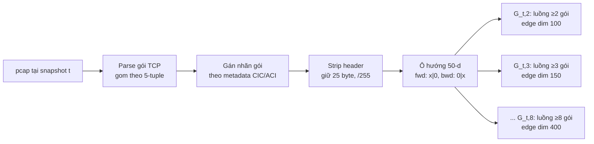
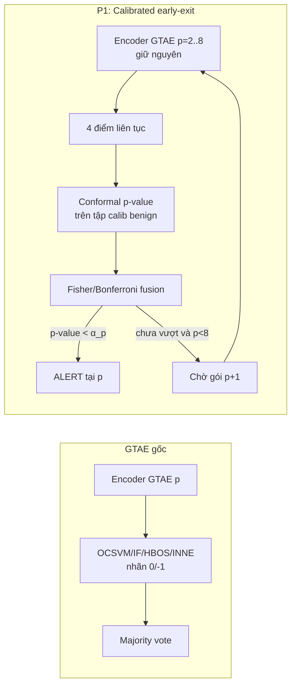

# GTAE-IDS — Phân tích, Kế hoạch tái hiện, So sánh và Đề xuất cải tiến

**Đồ án môn:** Hệ thống tìm kiếm, phát hiện và ngăn ngừa xâm nhập (IDPS) · **Nhóm:** B · **Định hướng:** Nghiên cứu
**Bài báo neo (anchor paper):** J. Ghadermazi, S. Hore, A. Shah, N. D. Bastian, "GTAE-IDS: Graph Transformer-Based Autoencoder Framework for Real-Time Network Intrusion Detection," *IEEE Trans. Inf. Forensics Security*, vol. 20, pp. 4026–4041, 2025, doi: 10.1109/TIFS.2025.3557741 (CC BY 4.0) — ký hiệu **[1]** trong tài liệu này.
**Ngày lập:** 13/10/2026

> **Quy ước trích dẫn trong tài liệu**
> - `[1, tr. 4030, §III-A.2]` = bài báo GTAE-IDS, trang (theo số trang tạp chí), mục. Số trang được đối chiếu trực tiếp từ bản PDF IEEE Xplore (16 trang, tr. 4026–4041).
> - Bảng (Table) và Hình (Fig.) đánh số **theo bài báo gốc**. Bài báo có 15 bảng (Table I–XV) và 5 hình; nội dung các bảng được đọc trực tiếp từ ảnh bảng trên IEEE Xplore.
> - **[PAPER]** = claim của tác giả; **[PHÂN TÍCH]** = suy luận của nhóm từ số liệu trong bài; **[GIẢ ĐỊNH]** = bài báo không nêu, nhóm phải tự chọn và ghi lại; **[THIẾU NGUỒN]** = chưa có dữ liệu, kèm cách lấy.
> - Số tham chiếu trong ngoặc vuông có tiền tố "GTAE" (vd. *GTAE[43]*) là số tham chiếu **bên trong** bài GTAE-IDS; số không tiền tố trỏ tới Bibliography cuối tài liệu này.

---

## Mục lục

0. Executive summary
1. Bối cảnh môn học & bài toán NIDS
2. Phân tích bài báo GTAE-IDS
3. Các bài báo liên quan và so sánh
4. Kế hoạch tái hiện (engineering spec)
5. Phân tích ưu/nhược điểm GTAE-IDS
6. Đề xuất cải tiến
7. Kế hoạch làm việc nhóm (WBS)
8. Báo cáo / demo / chấm điểm
9. Ethics & dual-use
- Phụ lục A — Checklist tái hiện
- Phụ lục B — Rủi ro & giảm thiểu
- Phụ lục C — Lịch 12 tuần (Gantt)
- Phụ lục D — Câu hỏi mở / giả định cần xác nhận với GVHD
- Bibliography (IEEE)

---

## 0. Executive summary

**Vấn đề paper giải.** Hầu hết NIDS dùng ML/DL hiện nay học trên *đặc trưng luồng* (flow features, kiểu CICFlowMeter) nên chỉ ra quyết định sau khi luồng kết thúc/timeout, dữ liệu ở dạng phẳng (vector/lưới) nên bỏ qua quan hệ cấu trúc giữa các thực thể mạng, và phần lớn là học có giám sát (supervised) nên cần nhãn và yếu với tấn công chưa thấy (zero-day) [1, tr. 4026–4027, §I].

**Ý tưởng cốt lõi GTAE-IDS** [1, §III]:
- Mỗi luồng TCP là **một cạnh vô hướng** giữa hai nút `(SrcIP, SrcPort)` và `(DstIP, DstPort)`; nút **không có đặc trưng**.
- Đặc trưng cạnh lấy từ **byte header của p gói đầu tiên** của luồng (p = 2…8): mỗi gói giữ đúng **25 byte** sau khi bỏ ETH, IP/TCP options, payload, và các trường IP/port/protocol; chuẩn hóa về [0,1]; mã hóa hướng bằng ô 50 chiều → đặc trưng cạnh có **2 × 25 × p** chiều.
- **Graph Transformer-based Autoencoder (GTAE)** bất đối xứng: encoder là các lớp graph transformer hoạt động trên cạnh (theo Dwivedi & Bresson [12]), decoder là DNN; huấn luyện **chỉ trên lưu lượng benign** bằng MSE tái tạo đặc trưng cạnh.
- Sau huấn luyện, **tách encoder** để sinh edge embedding; dùng 4 bộ phát hiện bất thường (OCSVM, IF, HBOS, INNE) huấn luyện trên embedding benign + **bỏ phiếu đa số (majority voting)**; đầu ra 0 = benign, −1 = bất thường.
- Một mô hình riêng cho mỗi giá trị p (7 mô hình GTAE, Table III).

**Đóng góp vs. gap** [1, tr. 4027–4028, §II-B]: gap là chưa có GNN-NIDS *packet-based* + *unsupervised*; GTAE-IDS lấp gap đó và báo TPR ensemble **99.04%** ở p = 8 trên CIC-IDS2017 (Table VI), >98% ở p = 8 khi chuyển sang CIC-IDS2018 và ACI-IoT-2023 (Table VIII), MDT 1.28 µs/gói (Table XIV).

**Các điểm nhóm phát hiện khi đọc kỹ số liệu (quan trọng cho đánh giá & cải tiến)** [PHÂN TÍCH]:
1. FPR của ensemble (5.91–8.94%) **cao hơn mọi detector đơn lẻ** (3.40–5.36%) ở cả 7 giá trị p (Table VI) → luật bỏ phiếu với 4 voter thực chất thiên về "báo động".
2. Thí nghiệm chuyển miền (CIC-IDS2018, ACI-IoT-2023) **chỉ dùng lưu lượng độc hại** [1, tr. 4036, §V-B] → không có FPR trong môi trường mới, nên claim "generalization" mới chứng minh được nửa vế.
3. 25 byte được giữ lại vẫn chứa **TTL, IP ID, IP checksum, TCP checksum, sequence/ack number** (Fig. 3) — hai checksum được tính từ chính IP/port đã bị xóa → rò rỉ gián tiếp; TTL là "lối tắt" (shortcut) đã biết của các bộ dữ liệu lab.
4. Với nút = (IP, port), cổng nguồn tạm thời (ephemeral) gần như duy nhất cho mỗi luồng: train-1 có 7.023–7.160 nút cho 5.000 cạnh (Table II) → bậc trung bình ≈ 1,4; ngữ cảnh đồ thị chủ yếu đến từ các "hub" dịch vụ đích.

**Scope đồ án nhóm B** (chi tiết §4.0): **MUST** — tái hiện pipeline trên CIC-IDS2017, TCP, p ∈ {2, 4, 8}, ≥ 2 lớp tấn công (DoS Hulk + PortScan) + benign, GTAE + IF + OCSVM, báo TPR/FPR. **SHOULD** — p = 2…8, đủ lớp tấn công của Table VII, 4 detector + voting, baseline B0/B1/B2. **MAY** — CIC-IDS2018 (kèm benign để đo FPR), đo latency, ablation.

**Kết quả kỳ vọng & tiêu chí thành công.** (i) Pipeline chạy end-to-end từ pcap → alert với 1 lệnh train + 1 lệnh eval; (ii) có đường cong TPR–p và FPR–p cho ít nhất 3 giá trị p; (iii) bảng "paper vs ours" có giải thích chênh lệch; (iv) một cải tiến chính (Proposal P1, §6) được đo bằng **TPR tại FPR mục tiêu cố định** và **số gói trung bình đến khi quyết định**, so với baseline GTAE của chính nhóm. Không đặt mục tiêu "đạt 99%": tiêu chí đạt là **tái hiện được xu hướng** (TPR tăng theo p; GTAE ≥ baseline không đồ thị B0 trong ablation tương ứng Table X).

**Rủi ro lớn nhất:** (1) gán nhãn gói từ metadata CIC (sai lệch múi giờ, lỗi nhãn đã được công bố [17]); (2) dung lượng pcap ~51 GB cho CIC-IDS2017; (3) bài báo **không công bố** một số siêu tham số (chiều Laplacian PE k, chiều ẩn d, sampler subgraph, luật hòa phiếu 2–2) → phải giả định và làm ablation; (4) GPU sinh viên — model nhỏ nên rủi ro thấp hơn rủi ro I/O.

---

## 1. Bối cảnh môn học & bài toán NIDS

### 1.1 Signature-based vs anomaly-based
- **Signature-based** (Snort/Suricata rules): so khớp mẫu đã biết; FPR thấp, không phát hiện được tấn công chưa có chữ ký.
- **Anomaly-based**: học hồ sơ "bình thường" rồi gắn cờ độ lệch; có khả năng phát hiện tấn công mới nhưng FPR cao hơn và khó giải thích. GTAE-IDS thuộc nhóm này: chỉ học benign, mọi điểm lệch khỏi phân phối benign bị đánh dấu −1 [1, tr. 4032–4033, §III-B.3].

### 1.2 Flow-based vs packet-based
| | Flow-based (vd. CICFlowMeter CSV) | Packet-based (GTAE-IDS, SPIN-IDS) |
|---|---|---|
| Đơn vị | Thống kê tổng hợp của cả luồng (số gói, độ dài TB, IAT min/max…) | Byte/trường của từng gói |
| Thời điểm ra quyết định | Sau khi luồng kết thúc hoặc timeout | Sau p gói đầu |
| Mất thông tin | Mẫu độc hại trong từng gói có thể bị "làm mờ" khi tổng hợp [1, §V-D.1] | Mất ngữ cảnh dài hạn của luồng |
| Phụ thuộc | Tập đặc trưng do công cụ quyết định, khác nhau giữa tổ chức [1, §II-B] | Cần pcap đầy đủ + gán nhãn gói |

**Không được nhầm:** GTAE-IDS **không** dùng file CSV CICFlowMeter làm đặc trưng. Nó đọc pcap thô, giữ byte header của gói. CSV (nếu dùng) chỉ là *metadata để gán nhãn*.

### 1.3 Supervised / semi-supervised / unsupervised
- **Supervised**: cần nhãn benign + từng loại tấn công (E-GraphSAGE [6], SPIN-IDS [2]).
- **Semi-supervised / one-class**: chỉ cần dữ liệu benign đã "sạch" (về bản chất GTAE-IDS là *one-class*: train chỉ benign — vẫn cần biết dữ liệu nào là benign).
- **Self-supervised** (Anomal-E [8], GraphIDS [10]): pretext task không dùng nhãn tấn công, sau đó có thể gắn detector.
- Bài báo gọi GTAE-IDS là *fully unsupervised* [1, §I]; chính xác hơn là **one-class/semi-supervised theo nghĩa cần tập benign sạch** [PHÂN TÍCH]. Điểm này nên nói rõ khi bảo vệ.

### 1.4 Vì sao biểu diễn đồ thị phù hợp lưu lượng mạng
Mạng là tập thực thể (host, dịch vụ) nối bằng các phiên giao tiếp; nhiều tấn công thể hiện ở *cấu trúc* (một nguồn → nhiều đích như PortScan; nhiều nguồn → một đích như DDoS) mà vector phẳng của từng luồng không thấy được [1, tr. 4026, §I; tr. 4027, §II-A]. GNN lan truyền thông tin giữa các luồng chung điểm cuối; graph transformer dùng attention để cân trọng các luồng "hàng xóm".

### 1.5 "Near real-time" trong paper nghĩa là gì
- **Early detection theo sự kiện:** đồ thị G_{t,p} được dựng khi luồng có đủ p gói; không đợi luồng kết thúc. Nếu phát hiện bất thường ở p = 3 thì dừng, không cần dựng đến p = 8 [1, tr. 4039, §V-E].
- **MDT (mean detection time):** 1.28 µs/gói khi test (GCT 0.06 + GRLT 0.81 + ADT 0.41 µs), 1.32 µs/gói khi triển khai thử ở 10.000 gói/s (GCT 0.06 + GRLT 0.83 + ADT 0.43 µs) [1, Table XIV; tr. 4039].
- **Lưu ý [PHÂN TÍCH]:** MDT là thời gian *xử lý trung bình chia theo gói* trên GPU (xử lý theo lô), **không bao gồm thời gian chờ p gói đến** và không phải độ trễ end-to-end của một luồng. Độ trễ đến quyết định thực tế ≈ (thời điểm gói thứ p tới − thời điểm gói 1) + thời gian xử lý snapshot. Với slowloris/low-and-slow, khoảng chờ này có thể là giây–phút.

---

## 2. Phân tích bài báo GTAE-IDS

### 2.1 Problem statement & motivation [1, tr. 4026–4027, §I]
Ba hạn chế mà tác giả nêu:
1. **Độ trễ của flow-based:** NIDS flow-based xử lý gói sau khi giao tiếp kết thúc → phù hợp phân tích hồi cứu (offline) hơn là phát hiện thời gian thực.
2. **Dữ liệu phẳng:** mô hình dùng vector/lưới không nắm được mẫu cấu trúc và ngữ cảnh của tấn công.
3. **Phụ thuộc nhãn:** GNN-NIDS phần lớn supervised/semi-supervised → (a) gán nhãn đồ thị tốn kém, đôi khi bất khả thi; (b) yếu với tấn công mới có mẫu cấu trúc chưa thấy.

### 2.2 Contributions [1, tr. 4027, §I]
Nguyên văn ý (diễn giải, không trích dài):
1. Hoạt động gần thời gian thực: thu lưu lượng và phân rã bằng các quá trình động để dựng **đồ thị dựa trên chuỗi gói** biểu diễn giao tiếp.
2. Dùng **graph autoencoder** học mẫu cấu trúc/toàn cục của benign theo cách **unsupervised** → không cần nhãn đồ thị, tăng khả năng phát hiện tấn công chưa thấy.
3. Coi chuỗi gói trong một giao tiếp giống chuỗi từ trong câu → dùng **transformer trong encoder** để nắm mẫu ngữ cảnh.
4. Đạt độ chính xác >98% trên CIC-IDS2017, CIC-IDS2018, ACI-IoT-2023 chỉ với **vài gói đầu** của luồng.

**Diễn giải:** đóng góp thật sự mới là *tổ hợp* (packet-level + graph + transformer + one-class AD), và **mã hóa đặc trưng cạnh 2×25×p** có kiểm soát bias. Phần anomaly detection (IF/OCSVM/HBOS/INNE + voting) là kỹ thuật chuẩn. Ý tưởng "p gói đầu là đủ" và cách cắt byte đã có từ công trình trước của cùng nhóm tác giả (SPIN-IDS [2] = GTAE[43]).

### 2.3 Related work (Table I) và gap (§II-B)
**Tóm lược Table I** [1, tr. 4028] — 15 công trình GNN-NIDS:

| Ref (GTAE) | Learning | Task | Graph | Thuật toán | Dữ liệu | Hiệu năng (theo Table I) |
|---|---|---|---|---|---|---|
| [3] | Sup. | Node | Homo., unattr. | GCN+FNN | Flow; botnet tổng hợp | 99% accuracy |
| [4] | Sup. | Node | Homo., unattr. | GCN+FNN | Flow; botnet tổng hợp | 98% F1 |
| [5] | Sup. | Node | Homo., unattr. | GIN | Flow; botnet tổng hợp | 99% F1 |
| [6] | Semi-sup. | Node | Hetero., unattr. | GCN | Flow; CTU-13 | 98.22% micro-F1 |
| [15] | Sup. | Node | Hetero., unattr. | GNN, GRU | Flow; CIC-IDS2017 | 99% weighted F1 |
| [19] | Sup. | Node | Homo., attr. | Graph Network | Flow; CTU-13 + synthetic | 99% AUC |
| [7] | Sup. | Edge | Hetero., attr. | Modified GraphSAGE | Flow; BoT-IoT, ToN-IoT, NF-* | 99% F1 |
| [8] | Sup. | Node | Homo., attr. | E-GraphSAGE, GAT | Flow; UNSW-NB15, CIC-Darknet2020, ToN-IoT, CIC-IDS2018 | 98% weighted-F1 |
| [20] | Sup. | Edge | Hetero., attr. | E-GraphSAGE | Flow; UNSW-NB15 | 99.88% F1 |
| [21] | **Unsup.** | Edge | Hetero., attr. | E-GraphSAGE, Isolation Forest | Flow; UNSW-NB15, CIC-IDS2018 | 96% macro-F1 |
| [22] | Sup. | Graph | Hetero., attr. | GIN | Flow; CIC-IDS2017, CIC-DoS-2017 | 96.5% F1 |
| [17] | Sup. | Edge | Spatio-temporal, attr. | ST-GCN | **Packet**; CAIDA + synthetic | 90% accuracy |
| [18] | Sup. | Node | Spatio-temporal, attr. | Auto Metric GNN | **Packet**; CSIC 2010, ISCXIDS2012 | 96% F1 |
| [9] | Sup. | Graph | Attr. | TCGNN | **Packet**; UNB-ISCX, TrafficX | 98.3% macro-F1 |
| [23] | Sup. | Graph | Attr. | GNN, FEATHER | **Packet**; CIC-IDS2017 | 99% accuracy |

**Gap (§II-B, tr. 4028):** (i) flow-based bị giới hạn ở phát hiện offline và phụ thuộc tập đặc trưng tùy ý; (ii) các NIDS packet-based hiện có đều supervised/semi-supervised trên attributed graph. Quan sát của nhóm: trong Table I chỉ có [21] (Anomal-E [8]) là unsupervised, và nó flow-based → gap "packet-based + unsupervised" là có thật theo chính bảng của tác giả.

### 2.4 Hình thức hóa [1, tr. 4029, §III]
Đồ thị động:
$$G_{t,p} = \left(V_{t,p},\ E_{t,p},\ X_{v,t,p},\ X_{e,t,p}\right)$$
- **Quá trình theo thời gian:** tập nút/cạnh thay đổi qua các timestamp $\{t, t+1, \dots, t+n\}$; t do tổ chức chọn (phút/giờ).
- **Quá trình theo sự kiện:** tại một t, cấu trúc đổi theo số gói p của từng giao tiếp.
- **Nút** [1, tr. 4029, §III-A.1]: $V_{t,p} = V^{\text{SrcIP,SrcPort}}_{t,p} \cup V^{\text{DestIP,DestPort}}_{t,p}$, và $X_{v,t,p} = \emptyset$.
- **Cạnh** [1, tr. 4030, §III-A.2]: một cạnh cho mỗi flow/session giữa cặp nút; đặc trưng cạnh $X_{e,t,p}$ lấy từ dữ liệu gói.
- **Loại đồ thị** [1, tr. 4030–4031, §III-A.3]: **vô hướng**, hướng gói được mã hóa trong đặc trưng cạnh.
- Lưu ý: khi phân rã snapshot thành các $G_{t,p}$, một số nút không còn trong đồ thị có p lớn hơn (luồng chưa đủ p gói) [1, tr. 4029].

### 2.5 Pipeline sinh đồ thị (chi tiết)

#### 2.5.1 Đầu vào và công cụ
pcap (định dạng de facto, Wireshark), công cụ libpcap/tshark [1, tr. 4029, §III-A]. Bài báo không công bố code.

#### 2.5.2 Gán nhãn gói
Bài báo: pcap không có nhãn; tác giả xử lý "theo quy trình trong GTAE[42], GTAE[43]" và gán nhãn dựa trên metadata của CIC (GTAE[44]) và ACI (GTAE[45]) [1, tr. 4034, §IV-A].
- GTAE[42] = **Deep PackGen** [3]: parse bằng **Scapy và dpkt**; gán nhãn mỗi gói theo **6-tuple (SrcIP, DstIP, SrcPort, DstPort, Protocol, epoch time)** đối chiếu với tài liệu tấn công trên website CIC [3, §3.1].
- GTAE[43] = **SPIN-IDS** [2]: mỗi ảnh (chuỗi gói của luồng) mang nhãn của luồng tương ứng trong dữ liệu công khai; CIC-IDS2017 có 15 nhãn (1 benign + 14 tấn công) [2, §III-B].
- **[THIẾU NGUỒN]** Cả hai bài không mô tả dung sai thời gian, xử lý múi giờ, hay xử lý xung đột nhãn. Nhóm phải tự đặc tả (§4.3).

**Quy trình gán nhãn nhóm áp dụng** (chi tiết ở §4.3): flow key 5-tuple → tra bảng lịch tấn công (ngày, khung giờ, IP attacker/victim) của CIC [15] → nhãn flow → nhãn gói kế thừa; đối chiếu chéo với CSV `GeneratedLabelledFlows` (khớp 5-tuple + timestamp ± dung sai); ghi nhận tỉ lệ không khớp.

#### 2.5.3 Cắt byte — từ tối đa 1594 byte còn 25 byte [1, tr. 4030, Fig. 3]
Gói TCP tối đa 1594 byte = ETH 14 + IP 20 + IP options ≤ 40 + TCP 20 + TCP options ≤ 40 + payload ≤ 1460. Bỏ tổng cộng 1569 byte, còn 25 byte:

| Bước | Bỏ | Lý do (theo paper) |
|---|---|---|
| (a) | ETH header 14 B (MAC) | Thông tin môi trường gây bias |
| (a) | IP options, TCP options | Tránh lệch căn chỉnh (misalignment) giữa gói có/không options [GTAE[27] = nPrint [5]] |
| (a) | Payload | Có thể mã hóa (HTTPS, FTPS); nhiều gói không có payload |
| (b) | IP: version/IHL (1 B, `45`), DS field (1 B, `00`), protocol (1 B, `06`), SrcIP (4 B), DstIP (4 B) | IP/protocol gây bias môi trường |
| (b) | TCP: SrcPort (2 B), DstPort (2 B) | Port gây bias môi trường |

**25 byte còn lại** (đối chiếu trực tiếp ví dụ hex của Fig. 3; offset tính từ đầu header tương ứng):

| # | Trường | Header | Offset | Bytes | Ví dụ Fig. 3 |
|---|---|---|---|---|---|
| 1–2 | Total Length | IP | 2–3 | 2 | `01 c7` |
| 3–4 | Identification | IP | 4–5 | 2 | `c5 00` |
| 5–6 | Flags + Fragment offset | IP | 6–7 | 2 | `40 00` |
| 7 | TTL | IP | 8 | 1 | `40` |
| 8–9 | Header checksum | IP | 10–11 | 2 | `de aa` |
| 10–13 | Sequence number | TCP | 4–7 | 4 | `6a 70 fd 5c` |
| 14–17 | Acknowledgment number | TCP | 8–11 | 4 | `36 30 df a9` |
| 18–19 | Data offset + Flags | TCP | 12–13 | 2 | `80 18` |
| 20–21 | Window | TCP | 14–15 | 2 | `01 79` |
| 22–23 | Checksum | TCP | 16–17 | 2 | `d0 aa` |
| 24–25 | Urgent pointer | TCP | 18–19 | 2 | `00 00` |

Kết quả Fig. 3(c): `01 c7 c5 00 40 00 40 de aa 6a 70 fd 5c 36 30 df a9 80 18 01 79 d0 aa 00 00` → **đây là test vector cho unit test** (§4.4). Sau đó hex → thập phân 0–255 → chia 255 về [0,1] [1, tr. 4030, Fig. 3(d)].

> **[PHÂN TÍCH] Rò rỉ gián tiếp còn sót:** IP header checksum được tính trên toàn bộ IP header *gồm cả SrcIP/DstIP*; TCP checksum tính trên pseudo-header gồm *IP, port, protocol* và cả payload. Do đó hai checksum (4 byte) là hàm của các trường đã bị xóa. TTL phản ánh hệ điều hành/số hop của máy tấn công (Kali trong lab CIC). Sequence/ack tuyệt đối là số ngẫu nhiên (ISN) → nhiễu. Đây là cơ sở cho ablation "header hygiene" (§4.8, P2 ở §6).

#### 2.5.4 Mã hóa hướng [1, tr. 4031, §III-A.3, Fig. 4]
Mỗi gói một ô 50 chiều:
- gói **fwd** (nguồn → đích): $[\,x_{1..25},\ \mathbf{0}_{25}\,]$
- gói **bwd** (đích → nguồn): $[\,\mathbf{0}_{25},\ x_{1..25}\,]$

Ghép p ô theo thứ tự đến → đặc trưng cạnh $\gamma_{ij} \in \mathbb{R}^{50p}$, tức **2 × 25 × p** [1, tr. 4034, §IV-B]. p = 3 → 150 chiều (ví dụ chính tác giả nêu).

#### 2.5.5 Chọn p = 2…8 [1, tr. 4034, §IV-B]
- Bỏ p = 1 vì gói đầu thường là SYN, không mang ý đồ độc hại.
- Dừng ở p = 8 vì GTAE[43] (SPIN-IDS) cho thấy số gói này đủ để phát hiện; SPIN-IDS báo gói thứ 4–9 của giao tiếp hai chiều là đủ [2, §I].

#### 2.5.6 Ví dụ một luồng TCP (minh họa nhóm tự dựng)
Client 192.168.10.5:51234 → web server 192.168.10.50:80, p = 3:
1. Pkt1 SYN (fwd), Pkt2 SYN-ACK (bwd), Pkt3 ACK (fwd).
2. Nút u = (192.168.10.5, 51234), v = (192.168.10.50, 80); cạnh (u, v) vô hướng.
3. Mỗi gói → strip → 25 byte → /255.
4. $\gamma_{uv} = [\,b^{(1)}, \mathbf{0}\ |\ \mathbf{0}, b^{(2)}\ |\ b^{(3)}, \mathbf{0}\,] \in \mathbb{R}^{150}$.
5. Luồng có < 3 gói → **không xuất hiện** trong $G_{t,3}$.



```
Snapshot t (số trên cạnh = số gói hiện có của luồng)
  (A,51234)--5--(S,80)      (B,40001)--2--(S,80)      (C,6000)--8--(D,22)
G_t,2 : cả 3 cạnh (lấy 2 gói đầu)          edge_attr: [3, 100]
G_t,3 : A–S, C–D  (B–S chỉ có 2 gói → loại) edge_attr: [2, 150]
G_t,8 : C–D                                 edge_attr: [1, 400]
```

### 2.6 Thành phần phát hiện bất thường [1, tr. 4031–4033, §III-B]

#### 2.6.1 Autoencoder và hàm mất mát
Encoder $f_\phi$, decoder $h_\theta$, $\mathbf{z} = f_\phi(\mathbf{x})$, $\hat{\mathbf{x}} = h_\theta(f_\phi(\mathbf{x}))$. Hàm mất mát (1):
$$\mathcal{L}_{AE}(\theta,\phi) = \frac{1}{n}\sum_{i=1}^{n}\left(\mathbf{x}^{(i)} - h_\theta\!\left(f_\phi(\mathbf{x}^{(i)})\right)\right)^2 \tag{1}$$
**Vì sao MSE, không MAE** [1, tr. 4031]: MAE phù hợp khi các đặc trưng khác thang đo; ở đây mọi đặc trưng cùng thang [0,1], và tác giả muốn phạt lỗi lớn nặng hơn lỗi nhỏ → MSE.

#### 2.6.2 Encoder graph transformer (theo [12] = GTAE[33]) — công thức (2)–(8)
Chiếu tuyến tính đặc trưng cạnh $\gamma_{ij} \in \mathbb{R}^{d_e}$:
$$e^{0}_{ij} = K^{0}\gamma_{ij} + k^{0},\qquad K^0 \in \mathbb{R}^{d\times d_e} \tag{2}$$
Laplacian positional encoding (LapPE) chiều k, **chỉ cộng ở lớp đầu vào**:
$$\lambda^{0}_{ij} = F^{0}\lambda_{ij} + f^{0};\qquad \hat{e}^{0}_{ij} = e^{0}_{ij} + \lambda^{0}_{ij},\qquad F^0\in\mathbb{R}^{d\times k} \tag{3}$$
Cập nhật cạnh ở lớp ℓ với H head:
$$\hat{e}^{\ell+1}_{ij} = O^{\ell}_{e}\ \Big\Vert_{k=1}^{H}\Big(\sum_{j\in\mathcal{N}_i} w^{k,\ell}_{ij}\, V^{k,\ell} e^{\ell}_{ij}\Big) \tag{4}$$
$$w^{k,\ell}_{ij} = \mathrm{softmax}_j\!\left(\frac{Q^{k,\ell}e^{\ell}_{ij}\cdot K^{k,\ell}e^{\ell}_{ik}}{\sqrt{d_k}}\right) \tag{5}$$
Residual + LayerNorm + FFN:
$$\hat{\hat{e}}^{\ell+1}_{ij} = \mathrm{LayerNorm}\big(e^{\ell}_{ij} + \hat{e}^{\ell+1}_{ij}\big) \tag{6}$$
$$\hat{\hat{\hat{e}}}^{\ell+1}_{ij} = W^{\ell}_{e,2}\,\mathrm{ReLU}\big(W^{\ell}_{e,1}\hat{\hat{e}}^{\ell+1}_{ij}\big),\quad W_{e,1}\in\mathbb{R}^{2d\times d},\ W_{e,2}\in\mathbb{R}^{d\times 2d} \tag{7}$$
$$e^{\ell+1}_{ij} = \mathrm{LayerNorm}\big(\hat{\hat{e}}^{\ell+1}_{ij} + \hat{\hat{\hat{e}}}^{\ell+1}_{ij}\big) \tag{8}$$
Biểu diễn cạnh ở lớp cuối là bottleneck **z** [1, tr. 4032].

**Diễn giải triển khai [PHÂN TÍCH]:** (5) là attention **giữa các cạnh chung đầu mút i** (cạnh $ij$ làm query, các cạnh $ik$ làm key). Tương đương: chạy transformer trên **line graph** $L(G)$ (nút của $L(G)$ = cạnh của $G$; hai nút kề nếu hai cạnh chung đầu mút). Đây **không** phải node-transformer chuẩn của Dwivedi & Bresson (vốn cập nhật nút, dùng cạnh làm bias). Ghi chú bất nhất: (4) viết $O_e\in\mathbb{R}^{d\times d}$ nhưng ghép H head kích thước $d_k$ cho ra $H d_k$; với Table III (vd. 3 head, out 8) thì $d$ không chia hết cho $H$ → nhóm dùng $d_k = d$ cho mỗi head và $O_e \in \mathbb{R}^{d\times Hd}$ [GIẢ ĐỊNH].

#### 2.6.3 Decoder DNN — công thức (9)–(11)
$$z_{i+1} = W_i z_i + b_i,\qquad a_{i+1} = g(z_{i+1}) \tag{9–10}$$
$$\hat{x} = W_{out}\, z_{final} + b_{out} \tag{11}$$
Decoder đơn giản giúp huấn luyện dễ; sau huấn luyện **tách encoder** làm mô hình triển khai nhẹ [1, tr. 4031].

#### 2.6.4 Bộ phát hiện bất thường trên embedding [1, tr. 4032–4033, §III-B.3]
- Không dùng ngưỡng reconstruction error thủ công (mean ± kσ) vì chọn ngưỡng tốn công và dễ sai; thay bằng mô hình ML huấn luyện trên embedding benign.
- 4 detector: **HBOS** (proximity-based, theo phân loại của tác giả), **IF** và **INNE** (outlier ensembles), **OCSVM** (tác giả xếp vào "linear model"; thực tế kernel tốt nhất là RBF, Table V).
- **Majority voting** 4 detector. Đầu ra **0 = benign, −1 = bất thường**.
- **[THIẾU NGUỒN]** Bài báo không nói cách phá hòa 2–2. Suy luận từ số liệu [PHÂN TÍCH]: nếu luật là "≥ 3/4 phiếu → anomaly" thì mỗi cạnh benign bị báo sai phải được ≥ 3 detector gắn cờ, nên $3\cdot\mathrm{FP}_{ens} \le \sum_m \mathrm{FP}_m$, tức $\mathrm{FPR}_{ens} \le \tfrac{4}{3}\,\overline{\mathrm{FPR}}$. Ở p = 2: $\overline{\mathrm{FPR}} = (3.40+5.19+5.16+4.83)/4 = 4.645\%$ → cận trên 6.19%, nhưng Table VI báo **8.94%**; ở p = 8: cận 6.30% < **6.56%**; vi phạm cận này xảy ra ở 6/7 giá trị p (chỉ p = 7 nằm trong cận: 5.91% ≤ 5.97%). Vậy luật ≥ 3/4 **mâu thuẫn** với số liệu; luật "≥ 2/4 (hòa → anomaly)" cho cận $2\cdot\overline{\mathrm{FPR}}$ (9.29% ở p = 2) thì nhất quán. Nhóm cài cả hai luật và báo cáo.

#### 2.6.5 Metrics [1, tr. 4033, §III-B.4]
- TPR (DR) = TP / tổng số mẫu bất thường; FPR (FAR) = FP / tổng số mẫu benign.
- Claim "accuracy > 98%" ở Abstract/§I thực chất tương ứng **TPR ensemble** (99.04% ở p = 8, Table VI). Bài báo **không** báo accuracy, precision, F1 hay AUROC. Với tập test 33–39 nghìn cạnh trong đó 5.000 benign (Table II), accuracy sẽ bị TPR chi phối.

### 2.7 Experimental setup [1, tr. 4033–4035, §IV]
- **Phần cứng:** Intel Core i9-12950HX (16 nhân, 24 luồng, cache 30 MB) + NVIDIA RTX A5500 16 GB GDDR6, CUDA/cuDNN [1, tr. 4033].
- **Train chỉ benign CIC-IDS2017** cho cả GTAE và detector; CIC-IDS2018 và ACI-IoT-2023 dùng để đánh giá trong môi trường mới [1, tr. 4034].
- Dữ liệu nhiều ngày được coi như **một snapshot tại t tùy ý** [1, tr. 4034, §IV-B].
- **Train set 1 (GTAE):** 5.000 cạnh benign · **Train set 2 (detector):** 2.000 cạnh benign, **không trùng** train 1 · **Test:** 5.000 cạnh benign + cạnh tấn công; DDoS và DoS Hulk giới hạn 5.000 cạnh mỗi loại.
- **Table II — kích thước đồ thị (nút, cạnh):**

| p | Edge feat. | Train 1 (benign) | Train 2 (benign) | Test 2017 (benign+mal.) | Test 2018 (chỉ mal.) |
|---|---|---|---|---|---|
| 2 | 100 | (7160, 5000) | (3736, 2000) | (44767, 38984) | (10792, 10443) |
| 3 | 150 | (7144, 5000) | (3351, 2000) | (46285, 37971) | (7439, 7166) |
| 4 | 200 | (7135, 5000) | (3145, 2000) | (45008, 36964) | (6833, 6669) |
| 5 | 250 | (7135, 5000) | (3143, 2000) | (44118, 36093) | (6569, 6418) |
| 6 | 300 | (7129, 5000) | (3136, 2000) | (43417, 35482) | (6332, 6197) |
| 7 | 350 | (7112, 5000) | (3126, 2000) | (41643, 33974) | (6176, 6064) |
| 8 | 400 | (7023, 5000) | (3106, 2000) | (40744, 33228) | (6116, 6012) |

- **Table III — kiến trúc GTAE theo p:**

| Model | Enc. layers | Heads | In feat. | Out feat. (z) | Dec. layers | Neurons/layer | Act. |
|---|---|---|---|---|---|---|---|
| GTAE(2) | 3 | 3 | 100 | 8 | 2 | 32, 64 | ReLU |
| GTAE(3) | 3 | 3 | 150 | 8 | 2 | 32, 64 | ReLU |
| GTAE(4) | 4 | 4 | 200 | 16 | 3 | 32, 64, 128 | ReLU |
| GTAE(5) | 5 | 6 | 250 | 32 | 3 | 32, 64, 128 | ReLU |
| GTAE(6) | 5 | 6 | 300 | 32 | 3 | 32, 64, 128 | ReLU |
| GTAE(7) | 6 | 8 | 350 | 64 | 4 | 32, 64, 128, 256 | ReLU |
| GTAE(8) | 6 | 8 | 400 | 64 | 4 | 32, 64, 128, 256 | ReLU |

- **Table IV — siêu tham số chung (grid search):** lr 0.001; 100 epoch; batch = 50 subgraph; Adam; attention dropout 0.1 (chỉ lớp cuối); FFN dropout 0.05 (mỗi lớp).
- **Table V — grid detector (đậm = tốt nhất):** OCSVM kernel {linear, poly, **rbf**, sigmoid}; IF n_estimators {20, 50, 100, **150**}; INNE n_estimators {50, **100**, 150, 200}; HBOS bins {5, 10, 15, **20**, 25, 30}; contamination (mọi detector) {0.001, **0.01**, 0.04, 0.05, 0.1}. Tác giả nhận xét contamination tối ưu nằm trong 0.01–0.05 [1, tr. 4035].
- **Subgraph sampling** khi train GTAE: có nêu nhưng **không mô tả** thuật toán lấy mẫu, kích thước subgraph [THIẾU NGUỒN].
- **Không công bố:** chiều LapPE k, chiều ẩn d (Table III chỉ có in/out), FFN width ngoài tỉ lệ 2d, seed, tiêu chí dừng sớm, tập dùng để chọn siêu tham số detector [THIẾU NGUỒN → Phụ lục D].

### 2.8 Kết quả của paper

**Table VI — CIC-IDS2017, TPR/FPR (%) theo p và detector** [1, tr. 4035]:

| p | OCSVM TPR/FPR | IF | HBOS | INNE | **Ensemble** |
|---|---|---|---|---|---|
| 2 | 81.56 / 3.40 | 79.78 / 5.19 | 77.80 / 5.16 | 83.75 / 4.83 | **84.47 / 8.94** |
| 3 | 90.47 / 3.81 | 90.60 / 4.83 | 90.58 / 4.78 | 90.80 / 5.04 | **91.02 / 7.61** |
| 4 | 94.39 / 3.98 | 94.36 / 4.96 | 94.52 / 4.87 | 94.46 / 4.89 | **94.72 / 6.60** |
| 5 | 96.48 / 3.79 | 95.36 / 4.83 | 95.70 / 4.84 | 95.08 / 5.13 | **97.16 / 6.84** |
| 6 | 98.02 / 3.70 | 96.01 / 5.10 | 96.75 / 5.36 | 97.32 / 5.13 | **98.44 / 6.73** |
| 7 | 98.12 / 3.51 | 95.14 / 4.76 | 97.62 / 4.75 | 98.21 / 4.88 | **98.72 / 5.91** |
| 8 | 98.46 / 4.03 | 96.66 / 4.93 | 97.73 / 4.96 | 96.47 / 4.99 | **99.04 / 6.56** |

**Table VII — CIC-IDS2017, p = 8, TPR (%) theo loại tấn công** (đồ thị test riêng cho từng loại; bảng không có cột FPR):

| Attack | (Nodes, Edges) | OCSVM | IF | HBOS | INNE | Ensemble |
|---|---|---|---|---|---|---|
| DoS GoldenEye | (6235, 6090) | 98.49 | 96.86 | 97.57 | 96.45 | 99.08 |
| Heartbleed | (2032, 1468) | 99.32 | 97.21 | 98.23 | 96.59 | 99.52 |
| DoS Slowhttptest | (1248, 964) | 99.59 | 98.34 | 99.17 | 98.55 | 99.79 |
| DoS Slowloris | (1294, 1002) | 99.20 | 97.80 | 98.60 | 97.21 | 99.60 |
| DoS Hulk | (5382, 5000) | 98.02 | 96.26 | 97.18 | 96.24 | 98.74 |
| PortScan | (8242, 6451) | 97.75 | 95.27 | 96.96 | 95.75 | 98.50 |
| DDoS | (6072, 5000) | 98.74 | 97.30 | 98.42 | 96.66 | 99.34 |
| Infiltration | (2437, 1764) | 99.66 | 98.36 | 98.81 | 97.73 | 99.83 |
| Web Attack-BruteForce | (189, 140) | 98.57 | 98.57 | 99.29 | 95.71 | 99.29 |
| SSH-Patator | (248, 175) | 98.86 | 97.14 | 98.29 | 96.00 | 98.86 |
| FTP-Patator | (265, 174) | 98.28 | 94.25 | 96.55 | 97.13 | 98.85 |

Ghi chú [PHÂN TÍCH]: Heartbleed có 1.468 cạnh — trong khi CIC-IDS2017 chỉ có một phiên Heartbleed 20 phút (15:12–15:32) [15]; số cạnh lớn bất thường so với một kết nối kéo dài cần được kiểm tra khi tái hiện. Bot (ARES), Web XSS, SQL Injection không có trong Table VII.

**Table VIII — Ensemble TPR (%) trên môi trường mới (test chỉ gồm lưu lượng độc hại):**

| p | CIC-IDS2018 (nodes, edges) | TPR | ACI-IoT-2023 (nodes, edges) | TPR |
|---|---|---|---|---|
| 2 | (10792, 10443) | 81.63 | (2365, 2344) | 79.02 |
| 3 | (7439, 7166) | 91.27 | (1734, 1720) | 88.94 |
| 4 | (6833, 6669) | 93.67 | (1607, 1554) | 93.21 |
| 5 | (6569, 6418) | 97.05 | (1545, 1521) | 94.87 |
| 6 | (6332, 6197) | 98.51 | (1436, 1392) | 96.76 |
| 7 | (6176, 6064) | 98.65 | (1378, 1283) | 97.88 |
| 8 | (6116, 6012) | 98.74 | (1305, 1149) | 98.21 |

**Table IX — Ensemble TPR (%) theo loại tấn công, p = 2…8** (tiêu đề bảng ghi "8 Packet" nhưng nội dung có đủ 2–8):

| Dataset | Attack | 2 | 3 | 4 | 5 | 6 | 7 | 8 |
|---|---|---|---|---|---|---|---|---|
| 2018 | DoS GoldenEye | 76.6 | 84.04 | 90.21 | 94.58 | 97.08 | 97.39 | 99.5 |
| 2018 | DoS Slowloris | 89.48 | 92.4 | 95.44 | 97.47 | 99.37 | 99.15 | 99.47 |
| 2018 | DDoS | 100 | 99.5 | 93.75 | 98.9 | 99.4 | 99.8 | 98.67 |
| 2018 | Infiltration | 96 | 100 | 95.92 | 97.78 | 100 | 100 | 100 |
| 2018 | Web Attack-BruteForce | 86.18 | 93.93 | 98.37 | 99.23 | 99.71 | 99.32 | 100 |
| 2018 | Web Attack XSS | 90.16 | 95.06 | 97.24 | 96.72 | 99.2 | 97.41 | 99.39 |
| 2018 | SSH-Patator | 76.18 | 82.08 | 94.38 | 96.48 | 97.65 | 97.92 | 98.51 |
| 2018 | FTP-Patator | 64.58 | 92.39 | 100 | 100 | 100 | 100 | 100 |
| ACI | Port Scan | 87.32 | 93.5 | 96.75 | 98.45 | 98.43 | 98.83 | 99.67 |
| ACI | DoS Slowloris | 93.22 | 94.76 | 95.92 | 97.58 | 98.65 | 99.32 | 99.56 |
| ACI | ICMP Flooding | 83.17 | 87.83 | 88.38 | 89.53 | 89.86 | 94.32 | 96.54 |
| ACI | Ping Sweep | 91.15 | 96.6 | 97.34 | 96.79 | 98.45 | 98.41 | 99.19 |
| ACI | ARP Spoofing | 76.18 | 84.18 | 84.38 | 86.98 | 93.65 | 95.82 | 97.31 |
| ACI | BruteForce | 67.58 | 84.38 | 94.1 | 95.32 | 97.32 | 98.23 | 98.43 |

Tác giả chọn 6/12 loại tấn công ACI làm đại diện [1, tr. 4036]. **[PHÂN TÍCH — điểm bất nhất cần hỏi]:** pipeline được định nghĩa cho gói TCP/IP 25 byte, nhưng ICMP Flooding, Ping Sweep (ICMP) và ARP Spoofing (không có IP/TCP header) vẫn có kết quả; bài báo không giải thích cách mã hóa các gói này.

**Table X — Ablation p = 8, TPR (%) có/không GRL:**

| | OCSVM | IF | HBOS | INNE | Ensemble |
|---|---|---|---|---|---|
| Không ngữ cảnh (detector trên edge feature thô) | 95.81 | 88.45 | 90.01 | 95.34 | 96.75 |
| Có GRL (GTAE) | 98.46 | 96.66 | 97.73 | 96.47 | 99.04 |
| Chênh lệch | +2.65 | +8.21 | +7.72 | +1.13 | +2.29 |

Văn bản nói cải thiện trung bình 4.4% TPR (khớp: trung bình 5 cột = 4.40) và **3.97% FPR**, nhưng Table X **không có cột FPR** — số FPR này không kiểm chứng được từ bảng [THIẾU NGUỒN: Table XVI ở supplemental appendix].

**Table XI — TPR so với GNN supervised flow-based trên CIC-IDS2017 (cân bằng benign/attack):**

| Method | Slowloris | Slowhttptest | Hulk | GoldenEye | Heartbleed | FTP-Pat. | SSH-Pat. | WebBF | Infiltr. | PortScan | DDoS |
|---|---|---|---|---|---|---|---|---|---|---|---|
| E-GraphSAGE | 0.973 | 0.983 | 0.989 | 0.992 | 0.983 | 0.966 | 0.962 | 0.954 | 0.963 | 0.974 | 0.965 |
| GNN-based [Pujol-Perich] | 0.982 | 0.974 | 0.993 | 0.991 | 0.978 | 0.993 | 0.986 | 0.734 | 0.983 | 0.981 | 0.991 |
| GraphDDoS | 0.967 | 0.956 | 0.993 | 0.978 | 0.981 | 0.983 | 0.976 | 0.967 | 0.974 | 0.991 | 0.983 |
| **GTAE-IDS** | 0.996 | 0.998 | 0.988 | 0.991 | 0.996 | 0.989 | 0.988 | 0.993 | 0.998 | 0.985 | 0.994 |

**Table XII — so với non-GNN packet-based trên CIC-IDS2017:** PL-RNN 0.564 / 2.91 µs; Packet2Vec 0.728 / 3.54; HAST-II 0.690 / 4.2; AEIDS 0.587 / 2.65; PayloadEmbeddings 0.954 / 2.73; PBCNN 0.983 / 7.89; **GTAE-IDS 0.990 / 1.28** (TPR / inference time per packet).

**Table XIII — so với SPIN-IDS (TPR %):**

| p | 2 | 3 | 4 | 5 | 6 | 7 | 8 |
|---|---|---|---|---|---|---|---|
| SPIN-IDS | 81.59 | 86.50 | 92.02 | 94.47 | 97.54 | 97.54 | 98.77 |
| GTAE-IDS | 84.47 | 91.02 | 94.72 | 97.16 | 98.44 | 98.72 | 99.04 |

**Table XIV/XV — thời gian:** GTAE-IDS (p = 8): train GCT 0.188 h + GRLT 4.202 h + ADT 1.04 h = **5.43 h**; MDT 0.06 + 0.81 + 0.41 = **1.28 µs**. Baseline: E-GraphSAGE 3.1 h / 1.2 µs; GNN-based 2.7 h / 1.45 µs; GraphDDoS 4.6 h / 2.12 µs (baseline không tính thời gian trích đặc trưng flow và chờ luồng kết thúc) [1, tr. 4039].

### 2.9 Limitations / threats to validity
Tác giả tự nêu [1, tr. 4039–4040, §VI]: hiệu năng phụ thuộc độ ổn định của mẫu benign; dịch chuyển phân phối theo thời gian làm giảm độ chính xác → đề xuất retrain định kỳ hoặc retrain thích ứng. Các mối đe dọa dưới đây là **[PHÂN TÍCH] của nhóm**, mỗi mục gắn bằng chứng trong bài:

| # | Mối đe dọa | Bằng chứng trong bài | Hệ quả |
|---|---|---|---|
| T1 | Snapshot "t tùy ý" gộp nhiều ngày | §IV-B, tr. 4034 | Đồ thị không tương ứng một cửa sổ thời gian thực; không đo được độ trễ dựng đồ thị online |
| T2 | Nút không có đặc trưng; nút = (IP, port) | §III-A.1; Table II: ~7.1k nút / 5k cạnh | Phần lớn nút nguồn bậc 1; ngữ cảnh chỉ từ hub dịch vụ đích |
| T3 | Bỏ payload | §III-A.2 | Mù với tấn công chỉ khác ở payload (SQLi, XSS — vắng trong Table VII; malware-in-payload) |
| T4 | Bias removal chưa triệt để | Fig. 3: giữ TTL, IP ID, 2 checksum, seq/ack | Có thể học shortcut của lab (TTL Kali, checksum phụ thuộc IP) |
| T5 | Scalability | Paper tránh "mỗi gói = 1 cạnh" bằng 1 cạnh/luồng (§II-A) | Hub dịch vụ lớn → line-graph dày đặc khi attention |
| T6 | Tín hiệu p gói đầu không đủ cho mọi tấn công | SPIN-IDS nói 4–9 gói [2]; ACI ICMP Flooding chỉ 96.54% ở p = 8 | Slowloris/low-and-slow/C2 mã hóa có thể giống benign trong 8 gói đầu |
| T7 | Chi phí Transformer | Train 5.43 h vs 2.7–4.6 h baseline (Table XIV/XV) | 7 model riêng cho 7 giá trị p |
| T8 | Nhiễu nhãn gói | Gán nhãn theo metadata flow [42],[43]; CIC-IDS2017 có lỗi nhãn đã công bố [17] | TPR/FPR có thể lệch do nhãn sai, nhất là Infiltration, Web Attack |
| T9 | FPR ở môi trường mới không được đo | §V-B: test 2018/ACI chỉ chứa mal. | "Generalization" chưa chứng minh vế false alarm |
| T10 | Ensemble làm FPR tăng | Table VI | Ở 10.000 luồng/giờ, FPR 6.56% ≈ 656 cảnh báo giả/giờ |
| T11 | Lựa chọn contamination | Table V: "best" được chọn bằng grid search; không nói tập validation | Nguy cơ chọn siêu tham số trên tập test |
| T12 | Chỉ TCP | §III-A.2 (mô hình TCP/IP 1594 B) | Nhưng ACI có ICMP/ARP — cách xử lý không rõ |

---

## 3. Các bài báo liên quan và so sánh

Chọn 12 bài, 3 nhóm. Với bài nhóm chưa đọc toàn văn trong đợt này, các con số không được ghi (đánh dấu [THIẾU NGUỒN]); mô tả phương pháp dựa trên bản gốc/abstract đã truy cập.

### Nhóm A — packet-based / early detection

#### A1. SPIN-IDS [2] (GTAE[43])
- **Citation:** J. Ghadermazi, A. Shah, N. D. Bastian, IEEE Trans. Big Data, vol. 11, no. 1, pp. 157–173, 2025, doi: 10.1109/TBDATA.2024.3403394.
- **Input:** pcap; mỗi gói giữ header (bỏ ETH, IP version, DS, protocol, IP, port, options) **và payload** → tối đa 1486 byte/gói + đặc trưng delta time; hướng mã hóa vào kênh ảnh (fwd → kênh R) [2, §III-A, III-B].
- **Learning:** supervised (CNN), nhãn theo luồng trong dữ liệu công khai, 15 nhãn với CIC-IDS2017.
- **Graph:** không; ảnh 2D P×Q, P = số gói, Q = 1486.
- **Dataset/metrics:** CIC-IDS2017, CIC-IDS2018; TPR theo p (Table XIII của [1]).
- **Real-time / zero-day:** early detection (gói 4–9 đủ); không thiết kế cho zero-day (supervised).
- **Ưu vs GTAE:** dùng payload; một kiến trúc CNN đơn giản; có delta time.
- **Nhược vs GTAE:** cần nhãn tấn công; không có ngữ cảnh giữa luồng.
- **Bài học:** cùng nhóm tác giả, cùng pipeline cắt byte → nguồn tốt nhất để suy ra chi tiết GTAE không công bố (thứ tự byte, hướng). Lưu ý so sánh Table XIII là **supervised + payload vs unsupervised + header-only**, không cùng điều kiện.

#### A2. Deep PackGen [3] (GTAE[42])
- **Citation:** S. Hore et al., arXiv:2305.11039, 2023.
- **Input:** pcap CIC-IDS2017/2018, parse bằng Scapy + dpkt; gán nhãn gói bằng 6-tuple gồm epoch time; giữ gói fwd; bỏ ETH, IP, port; zero-padding; /255 [3, §3.1].
- **Learning:** deep RL sinh gói đối kháng (không phải IDS).
- **Graph/Real-time/Zero-day:** không áp dụng.
- **Bài học:** là nguồn **duy nhất** mô tả quy trình gán nhãn gói mà GTAE dựa vào; cung cấp số gói fwd theo lớp (vd. CIC-IDS2017 DoS Hulk 1.246.802, DDoS 754.735, PortScan 162.360) — dùng để **sanity-check** pipeline của nhóm.

#### A3. PBCNN [4] (GTAE[51])
- **Citation:** L. Yu et al., "PBCNN: Packet bytes-based convolutional neural network for network intrusion detection," Comput. Netw., vol. 194, Art. 108117, 2021, doi: 10.1016/j.comnet.2021.108117.
- **Input:** byte thô của gói trong luồng/phiên; CNN phân cấp (mức gói rồi mức luồng).
- **Learning:** supervised.
- **Dataset/metrics:** CIC-IDS2017, CIC-IDS2018; TPR 0.983 / 7.89 µs theo Table XII của [1] (số do [1] báo).
- **Real-time:** SPIN-IDS nhận xét PBCNN tạo một ảnh từ mọi gói của luồng nên không hợp phát hiện thời gian thực [2, §II].
- **Ưu vs GTAE:** dùng nội dung byte đầy đủ hơn. **Nhược:** supervised, giữ cả trường định danh → nguy cơ bias.
- **Bài học:** baseline "byte-level không đồ thị" — B0/B1 của nhóm là phiên bản unsupervised tương ứng.

#### A4. nPrint [5] (GTAE[27])
- **Citation:** J. Holland, P. Schmitt, N. Feamster, P. Mittal, "New directions in automated traffic analysis," ACM CCS 2021, doi: 10.1145/3460120.3484758.
- **Input:** biểu diễn gói chuẩn hóa theo **bit**, căn chỉnh từng trường header cố định (trường vắng mặt = −1).
- **Learning:** khung chung cho AutoML trên nhiều bài toán phân tích lưu lượng.
- **Ưu vs GTAE:** giải quyết misalignment bằng căn chỉnh theo trường thay vì xóa options; giữ được thông tin options.
- **Nhược:** vector rất dài; không có ngữ cảnh đồ thị.
- **Bài học:** GTAE trích nPrint để biện minh việc xóa options. Ý tưởng "mỗi trường một vị trí cố định, giá trị vắng = mã riêng" có thể thay zero-padding của ô hướng (vì 0 cũng là giá trị byte hợp lệ, vd. urgent pointer = `00 00`).

### Nhóm B — GNN-IDS

#### B1. E-GraphSAGE [6] (GTAE[7])
- **Citation:** W. W. Lo et al., IEEE/IFIP NOMS 2022, pp. 1–9, doi: 10.1109/NOMS54207.2022.9789878.
- **Input:** NetFlow records (flow-based). **Graph:** nút = endpoint, cạnh = flow có đặc trưng; GraphSAGE mở rộng để dùng đặc trưng cạnh và phân loại cạnh.
- **Learning:** supervised. **Dataset:** BoT-IoT, ToN-IoT, NF-BoT-IoT, NF-ToN-IoT (Table I của [1]).
- **Real-time:** không (cần flow hoàn chỉnh). **Zero-day:** không.
- **Ưu vs GTAE:** đơn giản, inductive, có mã nguồn công khai, đã được tái sử dụng rộng rãi. **Nhược:** supervised; flow-based.
- **Bài học:** cấu trúc "nút = endpoint, cạnh = flow" giống GTAE → nhóm có thể dùng E-GraphSAGE encoder làm baseline B2 không-transformer.

#### B2. Modified E-GraphSAGE / E-ResGAT [7] (GTAE[8])
- **Citation:** L. Chang, P. Branco, arXiv:2111.13597, 2021.
- **Input:** flow; dựng đồ thị bipartite IP nguồn–đích rồi chuyển **line graph**, thêm nút residual để cân bằng hai tập [1, tr. 4027].
- **Learning:** supervised; GraphSAGE/GAT có kết nối residual.
- **Ưu vs GTAE:** xử lý mất cân bằng lớp; line graph tường minh. **Nhược:** supervised, flow-based.
- **Bài học:** xác nhận cách nhóm cài attention cạnh-cạnh của GTAE bằng **line graph** là hướng đã có tiền lệ.

#### B3. Anomal-E [8] (GTAE[21])
- **Citation:** E. Caville, W. W. Lo, S. Layeghy, M. Portmann, Knowl.-Based Syst., vol. 258, Art. 110030, 2022, doi: 10.1016/j.knosys.2022.110030.
- **Input:** NetFlow; nút = IP (đã bỏ port), cạnh = flow; đặc trưng nút là vector 1 hằng [8, §method].
- **Learning:** **self-supervised** — Deep Graph Infomax trên E-GraphSAGE 1 lớp (256 hidden), graph bị phá bằng cách xáo đặc trưng cạnh; sau đó PCA, IF, CBLOF, HBOS trên edge embedding.
- **Dataset/metrics:** NF-UNSW-NB15-v2, NF-CSE-CIC-IDS2018-v2; macro-F1. Ví dụ HBOS trên CSE-CIC-IDS2018 (contamination 0%): 86.28 → 94.51 khi dùng embedding thay đặc trưng thô.
- **Real-time:** không (flow). **Zero-day:** có (không dùng nhãn tấn công khi học biểu diễn).
- **Ưu vs GTAE:** pipeline "GNN self-supervised → detector cổ điển" giống hệt phần sau của GTAE nhưng có báo macro-F1 (gồm cả vế false alarm); nút = IP cho đồ thị kết nối hơn. **Nhược:** flow-based, cần luồng hoàn chỉnh.
- **Bài học:** (1) baseline đúng nghĩa nhất cho phần AD của GTAE; (2) cho thấy chọn nút = IP thay vì (IP, port) là khả thi → cơ sở cho Proposal P4.

#### B4. Pujol-Perich et al. [9] (GTAE[15])
- **Citation:** D. Pujol-Perich, J. Suárez-Varela, A. Cabellos-Aparicio, P. Barlet-Ros, "Unveiling the potential of graph neural networks for robust intrusion detection," ACM SIGMETRICS Perform. Eval. Rev., vol. 49, no. 4, pp. 111–117, 2022 (arXiv:2107.14756).
- **Input:** flow; đồ thị dị thể với nút host và nút flow (flow là nút trung gian chứa thống kê), xem xét hướng flow riêng [1, tr. 4027].
- **Learning:** supervised; message passing lặp, GRU (Table I của [1]).
- **Dataset:** CIC-IDS2017; trọng tâm là **độ bền** trước biến đổi đối kháng (thay đổi kích thước gói, thời gian giữa gói).
- **Ưu vs GTAE:** đánh giá robustness đối kháng — thứ GTAE không làm. **Nhược:** supervised, flow-based; WebAttack-BruteForce chỉ 0.734 trong Table XI của [1].
- **Bài học:** đề xuất thí nghiệm robustness tối thiểu cho GTAE (vd. thay đổi window size/TTL) như một mục MAY.

#### B5. GraphIDS [10]
- **Citation:** L. Guerra, T. Chapuis, G. Duc, P. Mozharovskyi, V.-T. Nguyen, "Self-supervised learning of graph representations for network intrusion detection," NeurIPS 2025 (arXiv:2509.16625).
- **Input:** NetFlow. **Model:** E-GraphSAGE embed mỗi flow theo ngữ cảnh cục bộ + Transformer masked autoencoder tái tạo embedding, **huấn luyện end-to-end**; điểm bất thường = lỗi tái tạo.
- **Learning:** self-supervised, không dùng nhãn tấn công trong mục tiêu tái tạo.
- **Metrics:** PR-AUC tới 99.98%, macro-F1 tới 99.61% trên các benchmark NetFlow (theo abstract).
- **Real-time:** tác giả thừa nhận cần đánh giá độ trễ toàn pipeline (thu thập, gom, tiền xử lý, suy luận).
- **Ưu vs GTAE:** gộp học biểu diễn và phát hiện trong một mục tiêu (GTAE tách rời: AE → detector); báo PR-AUC/macro-F1. **Nhược:** flow-based.
- **Bài học:** chỉ ra hạn chế "decoupled" của GTAE và hai bài trước → cơ sở cho đánh giá dựa trên **điểm số liên tục** (AUROC/PR-AUC) thay vì nhãn cứng.

### Nhóm C — Unsupervised AE / Transformer

#### C1. Kitsune [11]
- **Citation:** Y. Mirsky, T. Doitshman, Y. Elovici, A. Shabtai, "Kitsune: An ensemble of autoencoders for online network intrusion detection," NDSS 2018, doi: 10.14722/ndss.2018.23204.
- **Input:** từng gói → AfterImage: thống kê tăng dần có suy giảm theo thời gian theo nhiều ngữ cảnh (host, kênh, socket).
- **Learning:** unsupervised, ensemble autoencoder nhỏ; điểm = RMSE; ngưỡng từ giai đoạn huấn luyện.
- **Real-time:** **online thật sự**, xử lý từng gói, chạy trên thiết bị nhẹ. **Zero-day:** có.
- **Ưu vs GTAE:** streaming đúng nghĩa, không cần snapshot; có ngữ cảnh theo host qua thống kê. **Nhược:** đặc trưng thống kê thủ công, không học cấu trúc đồ thị.
- **Bài học:** baseline "online unsupervised packet-level" kinh điển; cơ chế thống kê suy giảm theo thời gian là cách rẻ để thêm **node features** (Proposal P4).

#### C2. Graph Transformer (Dwivedi & Bresson) [12] (GTAE[33])
- **Citation:** V. P. Dwivedi, X. Bresson, "A generalization of transformer networks to graphs," AAAI Workshop DLG, 2021 (arXiv:2012.09699).
- **Model:** attention giới hạn trong lân cận, **Laplacian eigenvector** làm positional encoding, BatchNorm/LayerNorm, biến thể có đặc trưng cạnh.
- **Ưu/nhược vs GTAE:** là nền của encoder GTAE. Bản gốc cập nhật **nút** (cạnh đóng vai trò điều chỉnh attention); GTAE đảo lại thành cập nhật **cạnh**. LapPE có mơ hồ dấu (sign ambiguity) — bản gốc dùng lật dấu ngẫu nhiên khi train [12], [13]; GTAE không nhắc.
- **Bài học:** khi cài LapPE phải (i) tính trên đồ thị vô hướng, (ii) xử lý thành phần liên thông nhỏ, (iii) random sign flip khi train (§4.6).

#### C3. GraphMAE [14]
- **Citation:** Z. Hou et al., "GraphMAE: Self-supervised masked graph autoencoders," ACM KDD 2022, doi: 10.1145/3534678.3539321.
- **Model:** che (mask) đặc trưng, tái tạo bằng **scaled cosine error**, re-mask trước decoder.
- **Ưu vs GTAE:** mục tiêu che-tái tạo ép mô hình dùng ngữ cảnh lân cận thay vì học hàm đồng nhất; GTAE tái tạo toàn bộ đầu vào bằng MSE → có thể "copy" đặc trưng cạnh, giảm vai trò đồ thị.
- **Bài học:** ứng viên Proposal P5 (thay mục tiêu huấn luyện) — được đánh giá nhưng không chọn làm proposal chính (§6).

#### Bối cảnh: paper trích dẫn GTAE-IDS (2025–2026)
Theo danh sách "Cited by" trên IEEE Xplore (47 trích dẫn, truy cập 13/10/2026), có các bài TIFS/TDSC như *UTFormer* (TIFS), *MambaTIG* (TDSC 2026), *Normality in Anomaly: Rethinking Traffic Labels* (TDSC 2026) và tổng quan GNN/GAE cho IDS trên Computer Networks 2026. Nhóm **chưa đọc** các bài này; nếu GVHD yêu cầu cập nhật, bài *Normality in Anomaly* là ưu tiên vì liên quan trực tiếp tới T8 (nhiễu nhãn) [THIẾU NGUỒN: cần đọc toàn văn].

### Bảng so sánh tổng

| Paper | Year | Input | Graph? | Learning | Early detect | Zero-day | Datasets | Main metric | Real-time claim | Weakness |
|---|---|---|---|---|---|---|---|---|---|---|
| **GTAE-IDS [1]** | 2025 | pcap, 25 B header × p | Có (nút IP:port, cạnh flow) | One-class AE + 4 AD + vote | Có (p = 2–8) | Có | CIC-IDS2017/2018, ACI-IoT-2023 | TPR, FPR | 1.28 µs/gói | FPR ensemble cao; FPR môi trường mới không đo; rò rỉ checksum/TTL |
| SPIN-IDS [2] | 2025 | pcap, header + payload | Không (ảnh) | Supervised CNN | Có (4–9 gói) | Không | CIC-IDS2017/2018 | TPR | Có | Cần nhãn |
| Deep PackGen [3] | 2023 | pcap | Không | Deep RL (sinh mẫu) | N/A | N/A | CIC-IDS2017/2018 | Evasion rate | N/A | Không phải IDS |
| PBCNN [4] | 2021 | Byte thô của luồng | Không | Supervised CNN | Hạn chế | Không | CIC-IDS2017/2018 | TPR | Không | Cần cả luồng; supervised |
| nPrint [5] | 2021 | Bit header căn chỉnh | Không | AutoML | Theo gói | Phụ thuộc mô hình | Nhiều | Nhiều | N/A | Vector rất dài |
| E-GraphSAGE [6] | 2022 | NetFlow | Có | Supervised | Không | Không | BoT-IoT, ToN-IoT, NF-* | F1 | Không | Supervised, flow |
| E-ResGAT [7] | 2021 | Flow | Có (line graph) | Supervised | Không | Không | UNSW-NB15, CIC-Darknet2020, ToN-IoT, CIC-IDS2018 | Weighted-F1 | Không | Supervised, flow |
| Anomal-E [8] | 2022 | NetFlow | Có (nút IP) | Self-sup. DGI + AD | Không | Có | NF-UNSW-NB15-v2, NF-CSE-CIC-IDS2018-v2 | Macro-F1 | Không | Flow, cần luồng xong |
| Pujol-Perich [9] | 2022 | Flow | Có (host + flow nodes) | Supervised | Không | Không | CIC-IDS2017 | F1, robustness | Không | Supervised |
| GraphIDS [10] | 2025 | NetFlow | Có | Self-sup. GNN + Transformer MAE | Không | Có | NetFlow benchmarks | PR-AUC, macro-F1 | Chưa đo end-to-end | Flow-based |
| Kitsune [11] | 2018 | Gói → thống kê | Không | Unsup. AE ensemble | Có (theo gói) | Có | Mạng camera IoT tự dựng | TPR/FPR, AUC | Online, thiết bị nhẹ | Đặc trưng thủ công |
| Graph Transformer [12] | 2021 | Đồ thị tổng quát | Có | (Kiến trúc) | N/A | N/A | ZINC, PATTERN, CLUSTER | MAE/Acc | N/A | Không đặc thù NIDS |
| GraphMAE [14] | 2022 | Đồ thị tổng quát | Có | Self-sup. masked AE | N/A | N/A | Benchmark đồ thị | Acc | N/A | Không đặc thù NIDS |

---

## 4. Kế hoạch tái hiện (engineering spec)

### 4.0 Quyết định scope
**Nhóm B chọn: MUST bắt buộc hoàn thành trước tuần 8, SHOULD là mục tiêu chính, MAY chỉ làm phần "CIC-IDS2018 kèm benign".**

| Mức | Nội dung | Tiêu chí xong |
|---|---|---|
| **MUST** | CIC-IDS2017, chỉ TCP; p ∈ {2, 4, 8}; benign + DoS Hulk + PortScan; GTAE + IF + OCSVM; TPR/FPR | Bảng TPR/FPR 3 × 2 detector; DoD §4.10 đạt |
| **SHOULD** | p = 2…8; đủ 11 lớp Table VII; 4 detector + voting (2 luật hòa); baseline B0, B1, B2; ablation Table X | Bảng tương ứng Table VI, VII, X + so sánh "paper vs ours" |
| **MAY** | CIC-IDS2018 có cả benign (đo FPR môi trường mới); đo latency end-to-end; ablation header hygiene; robustness | Mỗi mục 1 bảng + 1 đoạn phân tích |

**Thứ tự cắt khi thiếu GPU/thời gian (cắt từ trên xuống, ghi vào báo cáo tuần):**
1. ACI-IoT-2023 (cần tài khoản IEEE DataPort, 32 GB pcap) — **cắt đầu tiên**, không làm trong kế hoạch mặc định.
2. p ∈ {3, 5, 7} (giữ 2, 4, 6, 8 vẫn vẽ được đường cong).
3. INNE (chậm nhất), giữ HBOS.
4. Giảm GTAE(7/8) xuống 4 lớp encoder — ghi rõ là lệch Table III.
Không bao giờ cắt: benign held-out để đo FPR; temporal split; unit test strip_headers.

### 4.1 Môi trường & stack
| Thành phần | Chọn | Lý do |
|---|---|---|
| Python | 3.11 | Tương thích PyTorch 2.x, PyG |
| DL | PyTorch ≥ 2.2 | |
| Graph lib | **PyTorch Geometric (PyG)** | `LineGraph` transform, `AddLaplacianEigenvectorPE`, `subgraph`, `utils.softmax` theo nhóm; tài liệu nhiều; DGL ít được cập nhật hơn cho PyTorch mới |
| Parse pcap | **dpkt** (chính) + tshark (đối chiếu) | Scapy chậm với ~51 GB; dpkt nhanh, cho raw bytes; [3] dùng cả Scapy và dpkt |
| Lọc sơ bộ | `editcap`, `tshark -Y` | Cắt pcap theo khung giờ để debug |
| Lưu trữ | Parquet (pyarrow) | Cột hóa, nén tốt |
| AD | **PyOD** (`HBOS`, `IForest`, `INNE`, `OCSVM`) | Có đủ 4 detector, API `contamination` thống nhất, có `decision_function` |
| Config | YAML + `hydra` hoặc `omegaconf` | |
| Logging | CSV + TensorBoard (W&B tùy chọn) | |
| Seed | `seed ∈ {0, 1, 2}` cho mọi thí nghiệm chính | Báo mean ± std |

**Cấu trúc repo** (tiếp nối repo IDPS hiện có của nhóm nếu GVHD đồng ý; commit không ghi tên công cụ AI theo quy định môn):
```
gtae-ids-repro/
├── data/
│   ├── raw/            # pcap gốc (gitignore), SHA256SUMS
│   ├── processed/      # packets_{day}.parquet, flows_{day}.parquet
│   └── graphs/         # G_{split}_{p}.pt (PyG Data)
├── src/
│   ├── parse_pcap.py      # pcap -> packets parquet (first 8 pkt/flow)
│   ├── label.py           # gán nhãn flow/gói theo lịch CIC + đối chiếu CSV
│   ├── packet_encoder.py  # strip_headers, normalize, pack_direction, encode_edge
│   ├── graph_builder.py   # dựng G_{t,p}, sampling 5000/2000/5000
│   ├── pe.py              # Laplacian PE + edge PE
│   ├── model_gtae.py      # EdgeGraphTransformerLayer, GTAEEncoder, DNNDecoder
│   ├── train_gtae.py
│   ├── embed.py           # encoder-only -> embeddings .npy
│   ├── detectors.py       # 4 AD + voting + calibration
│   ├── baselines.py       # B0, B1, B2
│   └── eval.py            # metrics, bảng, đường cong
├── configs/  (data.yaml, gtae_p{2..8}.yaml, detectors.yaml, exp/*.yaml)
├── tests/    (test_encoder.py, test_graph.py, test_leakage.py)
├── experiments/  (runs/<exp_id>/<seed>/...)
├── notebooks/ (01_eda.ipynb, 02_graph_debug.ipynb)
└── reports/
```
Lệnh mục tiêu (DoD): `python -m src.train_gtae exp=M1_p8` và `python -m src.eval exp=M1_p8`.

### 4.2 Data acquisition & pháp lý
| Dataset | Nguồn chính thức | Kích thước | Ghi chú |
|---|---|---|---|
| CIC-IDS2017 | http://cicresearch.ca/CICDataset/CIC-IDS-2017/ (từ trang UNB CIC) | pcap: Mon 11.0 GB, Tue 11 GB, Wed 13 GB, Thu 7.8 GB, Fri 8.3 GB ≈ **51 GB** [15] | Có `GeneratedLabelledFlows.zip`, `MachineLearningCSV.zip`; trang không nêu license cụ thể, yêu cầu trích dẫn ICISSP 2018 |
| CSE-CIC-IDS2018 | AWS: `aws s3 sync --no-sign-request --region <region> "s3://cse-cic-ids2018/" <dest>` | [THIẾU NGUỒN: trang không nêu tổng dung lượng; dùng `aws s3 ls --summarize --recursive` để đo trước khi tải] | Cho phép phân phối lại nếu trích dẫn + link AWS registry |
| ACI-IoT-2023 | IEEE DataPort, doi: 10.21227/qacj-3x32 | PCAP 32.27 GB, Netflow CSV 596.91 MB, Labeled Payload 5.15 GB, Attack Timesheets 2.5 KB | Cần đăng nhập/subscription IEEE DataPort; license không ghi trên trang |

**Đĩa:** cần ≥ 120 GB trống cho CIC-IDS2017 (51 GB pcap + giải nén tạm + parquet). Chỉ lưu tối đa 8 gói đầu mỗi luồng TCP → parquet nhỏ (ước lượng vài GB) [GIẢ ĐỊNH, đo ở tuần 3].
**Pháp lý:** không commit/không chia sẻ lại pcap; chỉ commit script + checksum. **Checksum:** `sha256sum data/raw/*.pcap > data/raw/SHA256SUMS`; kiểm lại trước mỗi lần build lại parquet.

**Bảng lịch tấn công CIC-IDS2017** (theo trang CIC [15]; giờ địa phương, attacker Kali 205.174.165.73 ↔ firewall 205.174.165.80 / 172.16.0.1; victim web 192.168.10.50):

| Ngày (2017) | Attack | Khung giờ | Victim |
|---|---|---|---|
| Mon 03/07 | Benign | cả ngày | — |
| Tue 04/07 | FTP-Patator | 09:20–10:20 | 192.168.10.50 |
| Tue 04/07 | SSH-Patator | 14:00–15:00 | 192.168.10.50 |
| Wed 05/07 | DoS slowloris | 09:47–10:10 | 192.168.10.50 |
| Wed 05/07 | DoS Slowhttptest | 10:14–10:35 | 192.168.10.50 |
| Wed 05/07 | DoS Hulk | 10:43–11:00 | 192.168.10.50 |
| Wed 05/07 | DoS GoldenEye | 11:10–11:23 | 192.168.10.50 |
| Wed 05/07 | Heartbleed (port 444) | 15:12–15:32 | 192.168.10.51 |
| Thu 06/07 | Web BruteForce / XSS / SQLi | 09:20–10:00 / 10:15–10:35 / 10:40–10:42 | 192.168.10.50 |
| Thu 06/07 | Infiltration (Meta exploit, Cool disk, Dropbox) | 14:19–15:45 (nhiều cửa sổ) | 192.168.10.8, 192.168.10.25 |
| Fri 07/07 | Botnet ARES | 10:02–11:02 | 192.168.10.15/.9/.14/.5/.8 |
| Fri 07/07 | PortScan | 13:55–14:35 (FW on), 14:51–15:29 (FW off) | 192.168.10.50 |
| Fri 07/07 | DDoS LOIT | 15:56–16:16 (205.174.165.69/.70/.71) | 192.168.10.50 |

**Cảnh báo múi giờ [GIẢ ĐỊNH cần kiểm chứng]:** trang CIC không nêu múi giờ [15]. Timestamp trong pcap là epoch UTC. Nhóm phải xác định offset bằng cách tìm gói FTP đầu tiên từ 172.16.0.1 → 192.168.10.50:21 vào thứ Ba và đối chiếu với 09:20; ghi offset vào `configs/data.yaml`.

### 4.3 Packet extraction & labeling
**Bước 1 — lọc TCP/IPv4:**
```bash
# debug nhanh: cắt 30 phút quanh DoS Hulk
editcap -A "2017-07-05 13:40:00" -B "2017-07-05 14:05:00" Wednesday-workingHours.pcap wed_hulk.pcap   # giờ UTC sau khi xác định offset
tshark -r wed_hulk.pcap -Y "ip && tcp" -w wed_hulk_tcp.pcap
```
UDP/ICMP: **drop** trong scope chính (paper định nghĩa trên TCP). Ghi số lượng gói bị drop theo protocol. Nếu làm MAY, tạo thí nghiệm riêng `exp=udp_icmp` với encoding ghi rõ là mở rộng của nhóm.

**Bước 2 — flow key & giữ 8 gói đầu** (`src/parse_pcap.py`):
- `key = canonical(srcIP, srcPort, dstIP, dstPort, proto)` (sắp xếp hai đầu để gói hai chiều chung key).
- Hướng: endpoint gửi **gói đầu tiên quan sát được** là "src" (fwd). Yêu cầu gói đầu có cờ SYN và không có ACK; nếu không → `flow_started_before_capture = True`, **loại** khỏi đồ thị (ghi tỉ lệ) [GIẢ ĐỊNH: paper nói gói đầu thường là SYN, §IV-B].
- Kết thúc flow: FIN/RST hoặc idle > 120 s → key mới (tránh tái dùng 5-tuple) [GIẢ ĐỊNH].
- Chỉ lưu gói thứ 1…8; đếm tổng số gói của flow để thống kê.

```python
# parse_pcap.py (rút gọn)
import dpkt, socket
def iter_tcp(pcap_path):
    with open(pcap_path, "rb") as f:
        for ts, buf in dpkt.pcap.Reader(f):
            eth = dpkt.ethernet.Ethernet(buf)
            if not isinstance(eth.data, dpkt.ip.IP): continue
            ip = eth.data
            if not isinstance(ip.data, dpkt.tcp.TCP): continue
            yield ts, bytes(ip)[: ip.hl * 4 + ip.data.off * 4], ip   # IP+TCP header (có options)
```

**Bước 3 — gán nhãn** (`src/label.py`):
1. Với mỗi flow, lấy `t_first` (UTC → giờ CIC theo offset), cặp IP.
2. **Quy tắc lịch:** flow mang nhãn tấn công A nếu `t_first ∈ [start_A − 60 s, end_A + 60 s]` **và** một đầu là IP attacker (205.174.165.73 hoặc 172.16.0.1 sau NAT, hoặc IP attacker liệt kê riêng) **và** đầu kia là victim của A. Ngoài cửa sổ + không dính IP tấn công → `BENIGN`. Trong cửa sổ, đúng cặp IP nhưng không khớp đủ điều kiện (vd. sai port dịch vụ) → `UNCERTAIN` (loại khỏi train/test, đếm riêng).
3. **Đối chiếu chéo:** join với `GeneratedLabelledFlows` theo 5-tuple + `|t_csv − t_first| ≤ 2 s` [GIẢ ĐỊNH]. Báo ma trận đồng thuận (nhãn lịch × nhãn CSV).
4. Nhãn gói = nhãn flow (cột `label`, `attack_type`).
5. **NAT:** trong CIC-IDS2017 tấn công từ ngoài thấy ở trong dưới IP 172.16.0.1 (firewall nội bộ) [15] → quy tắc phải chấp nhận cả hai.
6. Đọc [17] (Engelen et al.) để biết các lỗi nhãn đã biết của CIC-IDS2017; nếu dùng nhãn sửa của [17] thì ghi rõ.

**QA bắt buộc** (in ra `reports/qa_labeling.md`):
| Kiểm tra | Ngưỡng cảnh báo |
|---|---|
| % flow `UNCERTAIN` | > 2% |
| % flow bất đồng lịch vs CSV | > 5% |
| % flow bỏ do không bắt đầu bằng SYN | ghi lại, không ngưỡng |
| Va chạm 5-tuple (tái dùng port trong 120 s) | ghi lại |
| Gói lỗi checksum (dpkt không parse / checksum sai) | > 0.1% |
| Số gói fwd/lớp so với Deep PackGen [3, Table 3] | lệch > 30% → điều tra |

**Schema parquet** `packets_{day}.parquet`:
`flow_id:int64, pkt_idx:int8 (1..8), ts:float64, dir:int8 (0=fwd,1=bwd), kept25:fixed_size_binary[25], label:int8 (0 benign,1 attack,-1 uncertain), attack_type:string, day:string`.
`flows_{day}.parquet`: `flow_id, src_ip, src_port, dst_ip, dst_port, t_first, n_pkts_total, label, attack_type, start_with_syn:bool`. **IP/port chỉ ở bảng flows để dựng nút — không bao giờ vào feature.**

### 4.4 Feature encoding (unit-testable) — `src/packet_encoder.py`
```python
import numpy as np
IP_KEEP  = [2,3, 4,5, 6,7, 8, 10,11]           # total len, ID, flags/frag, TTL, checksum
TCP_KEEP = [4,5,6,7, 8,9,10,11, 12,13, 14,15, 16,17, 18,19]  # seq, ack, off/flags, win, csum, urg

def strip_headers(ip_tcp: bytes) -> bytes:
    ihl = (ip_tcp[0] & 0x0F) * 4                # bỏ IP options
    tcp = ip_tcp[ihl:ihl+20]                    # chỉ 20 byte cố định -> bỏ TCP options
    out = bytes(ip_tcp[i] for i in IP_KEEP) + bytes(tcp[i] for i in TCP_KEEP)
    assert len(out) == 25
    return out

def normalize(b25: bytes) -> np.ndarray:        # (25,) float32 in [0,1]
    return np.frombuffer(b25, dtype=np.uint8).astype(np.float32) / 255.0

def pack_direction(x25: np.ndarray, direction: int) -> np.ndarray:   # (50,)
    slot = np.zeros(50, np.float32)
    if direction == 0: slot[:25] = x25
    else:              slot[25:] = x25
    return slot

def encode_edge(packets, p: int) -> np.ndarray:  # packets: list[(kept25, dir)] theo thứ tự
    assert len(packets) >= p
    return np.concatenate([pack_direction(normalize(b), d) for b, d in packets[:p]])  # (50p,)
```
**Unit tests** (`tests/test_encoder.py`):
- `test_fig3_vector`: đầu vào IP `45 00 01 c7 c5 00 40 00 40 06 de aa c0 a8 0a 32 c0 a8 0a 03` + TCP `db 2c 0c c4 6a 70 fd 5c 36 30 df a9 80 18 01 79 d0 aa 00 00` → đầu ra **đúng** `01 c7 c5 00 40 00 40 de aa 6a 70 fd 5c 36 30 df a9 80 18 01 79 d0 aa 00 00` (Fig. 3 của [1]).
- `test_ip_options`: IHL = 6 (24 B) → kết quả không đổi so với cùng gói bỏ options.
- `test_tcp_options`: data offset = 8 (32 B) → chỉ lấy 20 byte đầu.
- `test_no_ip_port_leak`: với 1.000 gói ngẫu nhiên, mọi byte SrcIP/DstIP/port/protocol không xuất hiện ở vị trí nào trong 25 byte theo thứ tự offset (kiểm tra bằng cách đổi IP/port và xác nhận chỉ byte checksum đổi — xem `test_checksum_dependency` dưới).
- `test_checksum_dependency` (**tài liệu hóa rò rỉ, không phải lỗi code**): đổi DstIP, tính lại checksum → byte 8–9 và 22–23 thay đổi. Kết quả test dùng làm bằng chứng cho T4.
- `test_dims`: `encode_edge(..., p=3).shape == (150,)`; fwd → nửa sau = 0; bwd → nửa đầu = 0.

### 4.5 Graph construction — `src/graph_builder.py`
- **Một đồ thị cho mỗi (split, p)** giống paper: mọi flow được chọn của split → cạnh trên cùng một đồ thị.
- **Node id:** `hash((ip, port))` → chỉ số liên tục qua dict; IP/port **không** lưu trong `Data`.
- **Data (PyG):** `edge_index: [2, E]` (lưu một chiều; khi message passing dùng `to_undirected`), `edge_attr: [E, 50p] float32`, `y: [E] int8`, `attack_type: [E]`, `flow_id: [E]`, `num_nodes: N`, `x = None` (hoặc `torch.ones(N,1)` nếu lib yêu cầu — không mang thông tin).
- **Sampling theo protocol paper** (Table II): train1 = 5.000 cạnh benign, train2 = 2.000 cạnh benign **không trùng flow_id** với train1, test = 5.000 benign + tấn công (DDoS và DoS Hulk ≤ 5.000 mỗi loại).
- **Split thời gian của nhóm (chống leakage, khác paper — ghi rõ):**
  - Protocol **R (paper-like):** random flow-level từ tất cả các ngày, seed cố định.
  - Protocol **T (temporal, mặc định của nhóm):** train1 + train2 từ **thứ Hai** (toàn benign); benign test từ các khoảng benign **thứ Ba–thứ Sáu**; tấn công từ thứ Ba–thứ Sáu. Báo cả R và T.
- **Điều kiện tồn tại cạnh:** flow có ≥ p gói (cùng flow có thể có mặt trong G_{·,2}…G_{·,8}; khi so sánh giữa các p, dùng **cùng tập flow_id có ≥ 8 gói** cho bảng "fixed-population", ngoài bảng giống paper).
- **Debug:** `notebooks/02_graph_debug.ipynb` vẽ subgraph 10 cạnh bằng networkx (nhãn cạnh = attack_type, độ dày = p), in degree histogram (kiểm tra số liệu "7.1k nút / 5k cạnh" của Table II).
- **Kiểm tra:** `tests/test_graph.py`: `G_p3.edge_attr.shape[1] == 150`; không có flow_id trùng giữa train1/train2/test; `y` của train1/train2 toàn 0.

### 4.6 Model GTAE — `src/model_gtae.py`
**Cài đặt attention cạnh-cạnh (eq. 4–5) bằng line graph:**
1. `L = LineGraph()(Data(edge_index=undirected(ei), num_nodes=N))` → nút của L = cạnh của G; hai cạnh kề nhau nếu chung đầu mút.
2. Mỗi lớp: với cạnh $ij$ (query), key/value là các cạnh kề trong L (gồm chính nó — self-loop) → `softmax` theo nhóm đích bằng `torch_geometric.utils.softmax`.
3. Hub dịch vụ (vd. DNS 192.168.10.3:53) tạo clique lớn trong L → **giới hạn bậc**: lấy mẫu tối đa `K_max = 32` láng giềng mỗi cạnh mỗi epoch [GIẢ ĐỊNH, ablation K ∈ {16, 32, 64}].

**Spec theo lớp (p = 8, theo Table III; ẩn d = 64 [GIẢ ĐỊNH: d = out features]):**

| Khối | Phép toán | Shape |
|---|---|---|
| Input | `edge_attr` | [E, 400] |
| Proj (2) | Linear 400 → 64 | [E, 64] |
| PE (3) | LapPE k = 8 → Linear 8 → 64, cộng | [E, 64] |
| Layer ℓ = 1..6 (4–8) | MHA H = 8, d_k = 64/head, O_e: 512 → 64; Add & LN; FFN 64 → 128 → 64 (ReLU, dropout 0.05); Add & LN; attention dropout 0.1 chỉ lớp 6 | [E, 64] |
| Bottleneck z | output lớp 6 | [E, 64] |
| Decoder (9–11) | 64 → 32 → 64 → 128 → 256 (ReLU) → Linear 256 → 400 | [E, 400] |

Với p khác: lấy đúng #layers, #heads, out, decoder từ Table III; d = out (8, 8, 16, 32, 32, 64, 64).

**Laplacian PE** (`src/pe.py`):
- Tính trên đồ thị G vô hướng của **mỗi subgraph** khi train (và toàn đồ thị khi embed): `AddLaplacianEigenvectorPE(k=8, is_undirected=True)`; nếu N < k+1 thì zero-pad.
- **Edge PE** $\lambda_{ij} = \phi_i + \phi_j$ (đối xứng, hợp đồ thị vô hướng) [GIẢ ĐỊNH; paper chỉ ghi $\lambda_{ij}$ có chiều k]. Ablation: $[\phi_i \Vert \phi_j]$ sắp theo hướng fwd; và LapPE tính trực tiếp trên L.
- Random sign flip của từng eigenvector mỗi batch khi train (theo [12], [13]).
- Chỉ cộng ở input (eq. 3).

**Huấn luyện** (`src/train_gtae.py`):
- Subgraph sampling [GIẢ ĐỊNH]: mỗi subgraph = chọn ngẫu nhiên 1 nút hạt giống trong train1, lấy 2-hop edge-induced subgraph, cắt còn ≤ 200 cạnh; batch = **50 subgraph** (Table IV).
- Adam, lr = 1e-3, 100 epoch (Table IV); early stopping trên **val MSE** của 10% cạnh train1 giữ lại (patience 10) [GIẢ ĐỊNH].
- Loss: MSE (eq. 1) trên toàn bộ 50p chiều (gồm cả các vị trí zero-pad của ô hướng — đúng như paper); log thêm MSE chỉ trên vị trí khác 0 để phân tích.
- Artifacts: `encoder.pt`, `decoder.pt`, `config.yaml`, `train_log.csv`, `pe_meta.json` (k, cách tính).
- Gradient clipping 1.0; mixed precision tắt (model nhỏ).

### 4.7 Detectors — `src/detectors.py`
- Fit **chỉ** trên embedding của train2 (benign) sinh bằng encoder đã đóng băng (embedding tính trên toàn đồ thị train2).
- Siêu tham số mặc định = giá trị đậm của Table V: OCSVM rbf, IF 150, INNE 100, HBOS 20 bins, contamination 0.01.
- **Chọn siêu tham số** bằng tập **benign validation** tách từ thứ Hai (không chạm test): chọn contamination để FPR_val gần mục tiêu; ghi rõ khác paper (paper không nói tập chọn).
- Voting 4 model, hai luật: `vote_strict` (≥ 3/4 → anomaly) và `vote_tie_anom` (≥ 2/4 → anomaly). Báo cả hai; so FPR với Table VI để suy luận luật của paper.
- Đầu ra theo quy ước paper: 0 benign, −1 anomaly (PyOD trả 0/1 → map 1 → −1).
- **Calibration FPR:** trên 2.000 cạnh benign held-out (thứ Hai, không thuộc train1/train2), lấy ngưỡng score ở phân vị (1 − α) cho α ∈ {0.01, 0.05}; báo FPR thực đo trên benign test.

### 4.8 Evaluation protocol (chống leakage)
**Nguyên tắc:**
1. Đơn vị chia là **flow** (cạnh), không bao giờ chia gói của cùng flow vào hai tập.
2. Mặc định protocol **T** (temporal); báo kèm R để so với paper.
3. Không dùng nhãn tấn công ở bất kỳ bước train/tuning nào; chỉ dùng ở eval.
4. Scaler: không có (dữ liệu đã /255) — tránh scaler fit trên test.
5. `tests/test_leakage.py`: (i) giao flow_id giữa các split = ∅; (ii) feature không chứa 12 byte IP/port/protocol; (iii) train1/train2 chỉ chứa `y == 0`; (iv) không có cột ngoài `edge_attr` đi vào model.

**Metrics:** TPR, FPR (chính, như paper); Precision, F1, **AUROC, PR-AUC** (dùng score liên tục: trung bình rank-normalized của 4 detector); confusion theo attack_type; **TPR@FPR = 1%** (để so công bằng giữa các detector).
**Đường cong early detection:** TPR(p) và FPR(p), p = 2…8, mỗi lớp tấn công.
**Latency** (`eval.py --latency`): đo riêng (a) parse + encode (ms/flow, CPU), (b) dựng đồ thị + PE, (c) encoder forward (GPU, batch 1 và batch lớn), (d) detector; báo µs/gói (để so 1.28 µs) **và** ms/flow end-to-end + "thời gian chờ gói thứ p" lấy từ timestamp thật (median, p95 theo lớp).
**Ablation tối thiểu:**
| ID | Thay đổi | So với |
|---|---|---|
| A1 | Encoder GCN/E-GraphSAGE thay transformer (= B2) | M1 |
| A2 | Bỏ LapPE | M1 |
| A3 | Ngưỡng reconstruction error (phân vị 99% của train2) thay 4 detector | M1 |
| A4 | p = 2 vs p = 8 (đã có trong đường cong) | — |
| A5 (MAY) | Header hygiene: bỏ TTL, 2 checksum; seq/ack → tương đối | M1 |
| A6 | Không đồ thị: detector trên edge feature thô (= B0, tương ứng Table X) | M1 |

**Bảng "paper vs ours"** (mẫu, điền sau tuần 8): cột `Paper (Table VI)`, `Ours-R`, `Ours-T`, `Δ`, `Giải thích` (subset, siêu tham số giả định, nhãn, split).

### 4.9 Experiments matrix
GPU-hours là ước lượng của nhóm cho 1 seed trên GPU cỡ T4/RTX 3060 [GIẢ ĐỊNH; paper báo 4.2 h GRLT cho p = 8 trên RTX A5500, Table XIV].

| ExpID | Dataset | p | Model | Detector | Goal | GPU-h | Priority |
|---|---|---|---|---|---|---|---|
| D0 | 2017 | — | — | — | Parse + label + QA | 0 (CPU ~6–10 h) | MUST |
| B0 | 2017 | 2,4,8 | Không (vector 50p) | IF, OCSVM, HBOS, INNE | Baseline không đồ thị (≈ Table X "without context") | 0 | MUST |
| B1 | 2017 | 2,4,8 | MLP-AE (50p→…→z→50p) | 4 AD + vote | AE không đồ thị | 0.5 | SHOULD |
| B2 | 2017 | 2,4,8 | E-GraphSAGE-AE (2 lớp, edge emb.) | 4 AD + vote | Đồ thị không transformer | 1 | SHOULD |
| M0 | 2017 | 2,4,8 | GTAE | IF | Tái hiện tối thiểu | 1.5 | MUST |
| M0b | 2017 | 2,4,8 | GTAE | OCSVM | Tái hiện tối thiểu | (dùng lại emb.) | MUST |
| M1 | 2017 | 2…8 | GTAE | 4 AD + vote (2 luật) | Tái hiện Table VI | 6 | SHOULD |
| M1-cls | 2017 | 8 | GTAE | 4 AD + vote | Tái hiện Table VII | (dùng lại) | SHOULD |
| A1–A3 | 2017 | 8 | biến thể | 4 AD + vote | Ablation | 3 | SHOULD |
| A5 | 2017 | 8 | GTAE hygiene | 4 AD + vote | Shortcut audit | 1 | MAY |
| X1 | 2018 (mal. + benign) | 2…8 | GTAE (train 2017) | vote | Generalization có FPR | 0.5 + I/O | MAY |
| L1 | 2017 | 8 | GTAE | vote | Latency | 0.2 | MAY |
| P1-* | 2017 | 2…8 | GTAE + Proposal P1 | conformal fusion | Cải tiến chính (§6) | 1 | SHOULD |

Mọi Exp chính chạy 3 seed.

### 4.10 Verification / Definition of Done
- [ ] `test_fig3_vector` pass: encode gói Fig. 3 ra đúng 25 byte; không chứa IP/port/protocol.
- [ ] Đồ thị p = 3 có `edge_attr.shape[1] == 150`; p = 8 có 400.
- [ ] GTAE: val MSE giảm ≥ 50% so với epoch 1, không NaN/Inf, cho p ∈ {2, 4, 8}.
- [ ] FPR của từng detector trên **benign held-out** được đo và nằm trong file kết quả.
- [ ] TPR/FPR cho DoS Hulk (volumetric) và PortScan (không volumetric).
- [ ] `README.md` có đúng 1 lệnh train + 1 lệnh eval chạy được từ máy sạch (sau khi tải data).
- [ ] `test_leakage.py` pass (không leakage IP/label vào feature, không trùng flow giữa split).
- [ ] `reports/qa_labeling.md` sinh tự động, mọi ngưỡng cảnh báo đã được giải thích.

---

## 5. Phân tích ưu/nhược GTAE-IDS

**Ưu điểm**
| Ưu điểm | Bằng chứng |
|---|---|
| Phát hiện sớm theo p gói | TPR tăng đều theo p (Table VI, VIII); p = 4 đã đạt 94.72% (CIC-IDS2017) |
| Không cần nhãn tấn công khi huấn luyện | Train chỉ benign (§IV-B) |
| Ngữ cảnh đồ thị có ích | Ablation +2.29 điểm TPR ensemble, +8.21 với IF (Table X) |
| Chuyển miền vế TPR tốt | ≥ 98.2% ở p = 8 trên 2018 và ACI (Table VIII) |
| Ensemble tăng TPR | Ensemble TPR ≥ mọi detector ở mọi p (Table VI) |
| Mã hóa có ý thức kiểm soát bias | Bỏ IP/port/protocol/MAC (Fig. 3) |
| Suy luận nhanh | 1.28 µs/gói (Table XIV) |

**Nhược điểm**
| Nhược điểm | Bằng chứng / lý do |
|---|---|
| Phụ thuộc pcap + gán nhãn gói khó | §IV-A; quy trình [42], [43] không mô tả dung sai |
| Bỏ payload | Không có XSS/SQLi/Bot trong Table VII |
| Snapshot thô | "t tùy ý" gộp nhiều ngày (§IV-B) |
| Chi phí train + 7 model riêng | 5.43 h (Table XIV), Table III |
| FPR cao ở mức vận hành | Ensemble 5.91–8.94% (Table VI) |
| Vô hướng + ô hướng zero-pad | 0 là giá trị byte hợp lệ (vd. urgent = `00 00`) → mơ hồ giữa "vắng" và "giá trị 0" [PHÂN TÍCH] |
| Chỉ nhị phân, không multi-class | Đầu ra 0/−1 |
| Không giải thích được | Không có phân tích attention/byte |
| Siêu tham số phụ thuộc p | Table III |
| Rò rỉ gián tiếp | Checksum phụ thuộc IP/port; TTL (Fig. 3) |
| Thiếu FPR khi chuyển miền | §V-B |

**Mức độ "real-time" thực sự [PHÂN TÍCH]:**
- Kiến trúc là **batch snapshot**: embedding của một cạnh phụ thuộc các cạnh khác trong cùng G_{t,p} (attention + LapPE tính trên cả đồ thị) → muốn chấm điểm một flow mới phải dựng lại/ cập nhật đồ thị và **tính lại eigenvector Laplacian**, chi phí này không có trong GCT 0.06 µs.
- MDT là thông lượng trung bình theo gói trên GPU, không phải độ trễ của một quyết định. Độ trễ thật = chờ đủ p gói + thời gian xử lý snapshot. Với DoS volumetric, 8 gói đến trong mili-giây; với slowloris có thể hàng giây.
- So sánh Table XV loại trừ thời gian chờ flow của baseline nhưng tính "đủ mọi bước" cho GTAE — thực ra GTAE cũng loại trừ thời gian chờ p gói. Kết luận: GTAE-IDS là **"early" (ít gói)** nhiều hơn là **"real-time" (streaming)**.

---

## 6. Đề xuất cải tiến

Năm proposal đã đánh giá; P1 là proposal chính.

### P1 (CHÍNH) — Fusion điểm số có hiệu chỉnh conformal + dừng sớm theo p (Calibrated Early-Exit GTAE)
- **Gap vá:** T10 (ensemble làm FPR tăng lên 6–9%), T11 (contamination chọn theo grid), và "real-time" chỉ là danh nghĩa (paper *đề xuất* dừng khi phát hiện ở p nhỏ [§V-E] nhưng **không đánh giá** cơ chế này).
- **Ý tưởng kỹ thuật:**
  1. Thay 4 nhãn cứng + majority vote bằng **điểm liên tục**: mỗi detector cho `decision_function`; chuẩn hóa từng điểm thành **conformal p-value** trên tập calibration benign $\mathcal{C}$ (không thuộc train1/train2): $\pi_m(x) = \frac{1 + |\{c \in \mathcal{C}: s_m(c) \ge s_m(x)\}|}{1 + |\mathcal{C}|}$.
  2. Gộp 4 p-value bằng **Fisher** hoặc lấy min có hiệu chỉnh Bonferroni ($4\cdot\min_m \pi_m$); báo động khi p-value gộp < α. Với giả thiết hoán đổi được (exchangeable) giữa calibration và benign test, FPR được chặn trên bởi α theo lý thuyết conformal [22].
  3. **Dừng sớm:** với mỗi flow, xét lần lượt p = 2, 3, …, 8; ở mỗi bước dùng α_p (ngân sách α chia theo bước, vd. $\alpha_p = \alpha/7$, Bonferroni) — báo động ngay khi vượt; nếu tới p = 8 chưa vượt → benign. Kết quả: mỗi flow có `p_decision`.
- **Thay đổi so với GTAE gốc:**

- **Effort:** S–M (không đổi encoder; chỉ thêm `src/calibrate.py`, `src/early_exit.py`); GPU ≈ 0 (dùng lại embedding). 4–6 tuần dư sức, bao gồm phân tích.
- **Cách đánh giá:**
  - *Phải thắng:* (i) **FPR thực đo ≤ α + 1 điểm %** với α ∈ {1%, 5%} trên benign test (protocol T) — baseline vote của paper không có bảo đảm này; (ii) **TPR@FPR = 1%** cao hơn majority vote tại cùng FPR (đường ROC); (iii) **số gói trung bình đến quyết định** cho flow tấn công < 8 và TPR tổng ≥ TPR ensemble p = 8 − 1 điểm.
  - *Được phép đánh đổi:* TPR ở p = 8 có thể giảm tối đa 1 điểm so với vote ≥ 2/4 nếu FPR giảm ≥ 3 điểm.
  - Thí nghiệm: P1-a (fusion tại p cố định) vs M1; P1-b (early exit) vs M1 p = 8; mỗi cái 3 seed, protocol T và R.
- **Rủi ro:** benign test lệch phân phối so với calibration (thứ Hai vs thứ Ba–Sáu) → FPR vượt α; *giảm thiểu:* báo cáo đó chính là kết quả (đo drift), thử calibration bằng benign ngày gần nhất (sliding calibration). Bonferroni quá bảo thủ → thử thêm Fisher.

### P2 — Header hygiene & kiểm tra shortcut
- **Gap:** T4 (checksum phụ thuộc IP/port, TTL, seq/ack ngẫu nhiên).
- **Ý tưởng:** biến thể 25→19 byte: bỏ IP checksum, TCP checksum, TTL; thay seq/ack tuyệt đối bằng **seq/ack tương đối** so với ISN của từng hướng (như Wireshark) mã hóa log-scale.
- **Effort:** S; GPU ~1 h. **Đánh giá:** nếu TPR/FPR giảm mạnh khi bỏ TTL/checksum → mô hình gốc dựa vào shortcut; thắng khi FPR trên CIC-IDS2018 (benign + mal.) tốt hơn bản gốc. **Rủi ro:** cần CIC-IDS2018 benign (MAY). *Khuyến nghị:* làm như ablation A5, không phải proposal chính.

### P3 — Một encoder dùng chung mọi p (masked multi-p)
- **Gap:** T7 (7 model riêng).
- **Ý tưởng:** luôn đưa 400 chiều (8 ô), ô chưa có gói = token "chưa đến" học được (thay vì 0); thêm embedding p; train bằng cách cắt ngẫu nhiên p ∈ [2, 8].
- **Effort:** M; GPU ~3 h. **Đánh giá:** TPR/FPR theo p không kém hơn 1 điểm so với 7 model riêng; số tham số và thời gian train giảm. **Rủi ro:** một model khó tối ưu cho cả p nhỏ và lớn.

### P4 — Đặc trưng nút nhẹ + định nghĩa lại nút
- **Gap:** T2 (bậc ~1,4; nút không đặc trưng).
- **Ý tưởng:** nút nguồn = IP (bỏ port tạm thời), nút đích = (IP, port dịch vụ); node feature = log-degree, số flow mới trong 10 s, tỉ lệ flow chưa hoàn tất handshake (thống kê kiểu Kitsune [11], chỉ dùng số đếm, không dùng giá trị IP).
- **Effort:** M; GPU ~3 h. **Đánh giá:** TPR PortScan/DDoS (tấn công cấu trúc) tăng ở p nhỏ; FPR không tăng. **Rủi ro:** tái đưa thông tin định danh qua cấu trúc, cần test leakage lại.

### P5 — Mục tiêu masked reconstruction (GraphMAE-style)
- **Gap:** AE tái tạo đầy đủ đầu vào có thể học hàm đồng nhất, giảm giá trị ngữ cảnh.
- **Ý tưởng:** che 30% ô gói, decoder tái tạo phần che bằng scaled cosine error [14].
- **Effort:** M–L. **Đánh giá:** AUROC và TPR@FPR = 1% tăng so với GTAE MSE. **Rủi ro:** thay đổi lớn, khó quy kết nguyên nhân khi so với paper.

### Các hướng đã xét và không chọn
- *Streaming temporal graph thật sự* — đúng gap T1 nhưng effort L (cập nhật LapPE online, cửa sổ trượt), vượt 4–6 tuần.
- *Payload-aware / TLS metadata (JA3, SNI)* — cần parse TLS, CIC-IDS2017 phần lớn tấn công là HTTP rõ; để làm hướng tương lai.
- *Hybrid với supervised classifier* — làm mất tính one-class, đi lệch thông điệp của paper.
- *Linear attention (Performer)* — MDT của paper đã ở mức µs; nút cổ chai thực tế là I/O và LapPE, không phải attention.
- *Explainability attention rollout* — có giá trị trình bày nhưng không có metric "thắng" rõ ràng; làm phụ nếu dư thời gian (heatmap 25 byte × p cho 1 flow DoS Hulk).

### Khuyến nghị cho nhóm B
**Chọn P1 làm proposal chính**, P2 chạy như ablation A5. Lý do: (a) vá đúng điểm yếu đo được từ số liệu của chính paper (FPR ensemble, early-exit chưa được đánh giá); (b) không phải huấn luyện lại encoder → khả thi trong 4–6 tuần kể cả khi GPU yếu; (c) đo được bằng metric rõ ràng (FPR thực đo vs α, TPR@FPR, số gói đến quyết định) so với baseline GTAE của chính nhóm.

---

## 7. Kế hoạch làm việc nhóm (WBS)

Vai trò giả định (một người có thể kiêm): **R** = Research, **D** = Data, **M** = Model, **E** = Eval, **W** = Write.

| ID | Tuần | Owner | Task | Input | Output artifact | Dep. | Ngày | Done khi |
|---|---|---|---|---|---|---|---|---|
| T1 | 1 | R | Đọc [1] + [2] + [3] | PDF | `notes/paper_digest.md` | — | 3 | Trả lời được 12 câu ở §8 |
| T2 | 1 | D | Tải CIC-IDS2017 pcap + checksum | Link CIC | `data/raw/`, `SHA256SUMS` | — | 2 | 5 pcap đủ dung lượng |
| T3 | 2 | R+W | Design doc (tài liệu này) duyệt với GVHD | T1 | `docs/design.md` v1 | T1 | 2 | GVHD chốt scope + trả lời Phụ lục D |
| T4 | 2 | M | Skeleton repo, config, CI test | — | repo + `pytest` xanh | — | 2 | `pytest` chạy |
| T5 | 3 | D | `parse_pcap.py` + parquet | T2 | `packets_*.parquet` | T2 | 4 | Wed parse < 2 h; số flow hợp lý |
| T6 | 3 | D | Xác định offset múi giờ | T5 | `configs/data.yaml` | T5 | 1 | Gói FTP-Patator đầu tiên khớp 09:20 |
| T7 | 3–4 | D | `label.py` + QA | T5, T6 | `flows_*.parquet`, `qa_labeling.md` | T6 | 4 | Ngưỡng QA đạt hoặc đã giải thích |
| T8 | 3 | M | `packet_encoder.py` + test | — | `tests/test_encoder.py` | T4 | 2 | `test_fig3_vector` pass |
| T9 | 4 | M | `graph_builder.py` + `pe.py` + sampling | T7, T8 | `graphs/*.pt` | T7 | 3 | Bảng tương tự Table II |
| T10 | 4 | E | Baseline B0 | T9 | `results/B0.csv` | T9 | 1 | TPR/FPR p = 2,4,8 |
| **M2** | 4 | all | **Data + graph debug xong** | | | | | DoD mục 1, 2 |
| T11 | 5 | M | `model_gtae.py` (line-graph attention) | T9 | model + unit test shape | T9 | 4 | Forward/backward không lỗi |
| T12 | 5–6 | M | `train_gtae.py` p = 2,4,8 | T11 | `encoder.pt` ×3 | T11 | 4 | Val MSE giảm, không NaN |
| **M3** | 6 | all | **GTAE train được** | | | | | DoD mục 3 |
| T13 | 7 | E | `embed.py` + `detectors.py` + voting | T12 | `results/M0*.csv` | T12 | 3 | Scope MUST xong |
| T14 | 7–8 | M+E | M1 p = 2…8, Table VII per-class, B1, B2 | T13 | `results/M1*.csv` | T13 | 5 | Bảng Table VI/VII của nhóm |
| **M4** | 8 | all | **Detectors + số liệu** | | | | | Bảng "paper vs ours" bản nháp |
| T15 | 9 | E | Ablation A1–A3, (A5) | T14 | `results/ablation.csv` | T14 | 3 | 1 bảng ablation |
| T16 | 9–10 | M+E | Proposal P1 (calibrate + early exit) | T14 | `src/calibrate.py`, `results/P1*.csv` | T14 | 5 | Metric P1 đo xong, 3 seed |
| T17 | 10 | R | So sánh related work bổ sung (nếu GVHD yêu cầu) | §3 | `docs/related.md` | — | 2 | Bảng tổng cập nhật |
| **M5** | 10 | all | **Comparison + improvement** | | | | | |
| T18 | 11 | W | Báo cáo | all | `reports/report.pdf` | M5 | 4 | Đủ chương §8 |
| T19 | 11 | W+E | Slide + demo | all | `slides.pdf`, `demo/` | M5 | 3 | Demo chạy < 5 phút |
| T20 | 12 | all | Tổng duyệt, Q&A | T18, T19 | — | — | 2 | Trả lời thử 12 câu |
| **M6** | 12 | all | **Nộp + bảo vệ** | | | | | |

---

## 8. Báo cáo / demo / chấm

### 8.1 Outline báo cáo
1. Giới thiệu (bài toán NIDS, động cơ early + unsupervised)
2. Cơ sở lý thuyết (packet vs flow; graph transformer; AE; one-class AD; conformal)
3. Phân tích phương pháp GTAE-IDS (§2 của tài liệu này, rút gọn)
4. Tái hiện: dữ liệu, gán nhãn, pipeline, cài đặt, giả định
5. Kết quả tái hiện + so sánh với paper (+ giải thích chênh lệch)
6. So sánh với các công trình liên quan
7. Đề xuất cải tiến P1 + thí nghiệm + phân tích
8. Hạn chế, đạo đức, hướng phát triển
Phụ lục: QA nhãn, siêu tham số, lệnh chạy

### 8.2 Slide (14 trang)
1. Tiêu đề · 2. Bài toán & 3 hạn chế · 3. Ý tưởng GTAE-IDS (1 hình pipeline) · 4. Cắt 25 byte + ô hướng (Fig. 3 mô phỏng lại) · 5. Encoder line-graph attention · 6. Detector + voting · 7. Kết quả paper (Table VI rút gọn) + 3 điểm nhóm phát hiện · 8. Pipeline tái hiện & gán nhãn · 9. Kết quả nhóm vs paper · 10. Ablation · 11. Related work (bảng tổng rút gọn) · 12. P1: ý tưởng · 13. P1: kết quả (ROC, FPR vs α, số gói đến quyết định) · 14. Kết luận & hạn chế

### 8.3 Demo 5 phút
`demo/run_demo.sh demo/wed_hulk_10min.pcap` (pcap cắt 10 phút quanh DoS Hulk bắt đầu, do nhóm tự cắt, không phân phối lại):
1. Parse + encode (in 1 gói: 25 byte hex, so với Fig. 3 format) — 30 s
2. Dựng G_{t,2}…G_{t,8}, in số nút/cạnh — 30 s
3. Encoder + P1 early-exit, in bảng alert: `flow_id, p_decision, fused p-value` — 1 phút
4. Tổng kết: TPR/FPR trên đoạn pcap, histogram p_decision — 1 phút
5. Hỏi đáp — phần còn lại

### 8.4 Câu hỏi GVHD có thể hỏi
| Câu hỏi | Trả lời dự kiến |
|---|---|
| GTAE-IDS là supervised hay unsupervised? | One-class: train chỉ benign, không nhãn tấn công; cần tập benign sạch. Không phải classifier supervised. |
| Vì sao bỏ IP/port mà vẫn dựng nút bằng IP/port? | IP/port dùng để **xác định cấu trúc** (ai nói với ai), không vào feature; nhưng cấu trúc vẫn mang thông tin môi trường (đã nêu ở T2/P4). |
| 25 byte gồm gì? | 9 byte IP (len, ID, flags/frag, TTL, checksum) + 16 byte TCP (seq, ack, off/flags, window, checksum, urg); test vector từ Fig. 3. |
| Sao không dùng p = 1? | Gói đầu là SYN, gần như giống nhau giữa benign và tấn công (§IV-B). |
| Attention trong (5) khác transformer chuẩn chỗ nào? | Attention giữa các **cạnh** chung đầu mút → cài bằng line graph. |
| Real-time thật không? | Early (ít gói) đúng; streaming thì không: snapshot + LapPE toàn đồ thị; MDT không gồm thời gian chờ p gói. |
| Vì sao kết quả nhóm thấp hơn paper? | Split thời gian (T), nhãn khác, siêu tham số không công bố (k, d, sampler), chỉ TCP — có bảng giải thích. |
| Ensemble tốt hơn không? | TPR cao hơn nhưng FPR cao hơn mọi detector (Table VI) → động cơ của P1. |
| Làm sao biết không leakage? | `test_leakage.py`, split theo flow và theo ngày, nhãn không dùng khi train/tune. |
| P1 bảo đảm FPR như thế nào? | Conformal p-value chặn FPR ≤ α nếu benign test hoán đổi được với calibration; đo thực tế để kiểm drift. |
| Gán nhãn gói làm thế nào? | Lịch tấn công CIC (giờ + IP) + đối chiếu CSV flow; QA tỉ lệ bất đồng; tham khảo lỗi nhãn đã biết [17]. |
| Payload bị bỏ thì sao? | Mù với tấn công nằm trong payload; XSS/SQLi/Bot vắng trong Table VII; hướng tương lai là metadata TLS. |

---

## 9. Ethics & dual-use
- Mục tiêu duy nhất: **NIDS phòng thủ**. Không phát triển, không chạy, không công bố mã khai thác hay công cụ tấn công; không tái tạo tấn công trên hạ tầng thật.
- Dataset chỉ dùng cho mục đích học thuật, tuân điều kiện của CIC (trích dẫn) và IEEE DataPort; **không phân phối lại pcap** (pcap CIC-IDS2017 chứa payload thật của lab).
- Không thu lưu lượng mạng ngoài lab; demo chỉ dùng pcap công khai đã cắt, chạy offline.
- Deep PackGen [3] (sinh gói đối kháng) chỉ được trích để hiểu quy trình gán nhãn; nhóm không triển khai phần sinh mẫu né tránh.
- Báo cáo nêu rõ giới hạn (FPR, drift) để tránh việc kết quả bị hiểu là sẵn sàng triển khai sản xuất.

---

## Phụ lục A — Checklist tái hiện (reproducibility)

**Dữ liệu**
- [ ] Phiên bản dataset, ngày tải, SHA256 của từng pcap
- [ ] Offset múi giờ đã xác định và cách xác định
- [ ] Bảng lịch tấn công dùng để gán nhãn (file YAML trong repo)
- [ ] Báo cáo QA nhãn (§4.3)
- [ ] Số flow/gói theo lớp sau mỗi bước lọc

**Tiền xử lý**
- [ ] Danh sách offset byte giữ lại (IP_KEEP, TCP_KEEP) + test Fig. 3
- [ ] Quy tắc hướng, quy tắc bắt đầu/kết thúc flow, xử lý flow không có SYN
- [ ] Protocol split (R hay T) và seed

**Mô hình**
- [ ] Config đầy đủ cho mỗi p (layers, heads, d, k, edge-PE, K_max, sampler)
- [ ] Danh sách mọi [GIẢ ĐỊNH] đã chọn và giá trị
- [ ] Phiên bản thư viện (`pip freeze > env.txt`), GPU, CUDA
- [ ] Log loss train/val, checkpoint

**Đánh giá**
- [ ] Siêu tham số detector + tập dùng để chọn
- [ ] Luật voting (≥2/4 hay ≥3/4)
- [ ] TPR, FPR, Precision, F1, AUROC, PR-AUC, TPR@FPR = 1% — mean ± std 3 seed
- [ ] Bảng paper vs ours + giải thích
- [ ] Lệnh tái tạo từng bảng/hình trong báo cáo

## Phụ lục B — Bảng rủi ro + mitigation

| # | Rủi ro | Xác suất | Ảnh hưởng | Giảm thiểu | Trigger |
|---|---|---|---|---|---|
| R1 | Sai múi giờ khi gán nhãn | Cao | Cao | Xác định offset bằng gói tấn công đầu tiên (T6); test tự động | QA: tỉ lệ flow attack ngoài cửa sổ > 2% |
| R2 | Lỗi nhãn gốc CIC-IDS2017 | Trung bình | Trung bình | Đọc [17]; báo cáo kết quả theo lớp; loại `UNCERTAIN` | Lớp có TPR bất thường (vd. 100%/0%) |
| R3 | Thiếu đĩa/tải chậm (51 GB) | Trung bình | Cao | Tải từ tuần 1; xử lý từng ngày, xóa file tạm; cắt pcap bằng `editcap` | Đĩa trống < 30 GB |
| R4 | GPU yếu/hết quota Colab | Trung bình | Trung bình | Model nhỏ; thứ tự cắt §4.0; lưu checkpoint mỗi epoch | Train p = 8 > 8 h |
| R5 | Siêu tham số không công bố → lệch lớn với paper | Cao | Trung bình | Ablation k, d, K_max; báo cáo minh bạch; mục tiêu là xu hướng | TPR p = 8 < 90% |
| R6 | Line-graph quá dày ở hub | Trung bình | Trung bình | Lấy mẫu K_max láng giềng; subgraph ≤ 200 cạnh | OOM |
| R7 | Leakage vô tình (flow trùng, scaler) | Thấp | Cao | `test_leakage.py` chạy trong CI | Test fail |
| R8 | P1 không cải thiện | Trung bình | Thấp | Kết quả âm vẫn có giá trị (FPR drift đo được); dự phòng P2 | Sau tuần 9 |
| R9 | Không truy cập được ACI-IoT-2023 | Cao | Thấp | Ngoài scope mặc định | — |
| R10 | Thành viên vắng | Trung bình | Trung bình | Mỗi task có người backup; tài liệu hóa trong repo | Trễ milestone > 3 ngày |

## Phụ lục C — Lịch 12 tuần (Gantt)

| Hạng mục | T1 | T2 | T3 | T4 | T5 | T6 | T7 | T8 | T9 | T10 | T11 | T12 |
|---|---|---|---|---|---|---|---|---|---|---|---|---|
| Đọc paper, survey | ██ | ██ | | | | | | | | | | |
| Tải data + checksum | ██ | | | | | | | | | | | |
| Design doc + GVHD | | ██ | | | | | | | | | | |
| Parse + label + QA | | | ██ | ██ | | | | | | | | |
| Encoder bytes + graph | | | ██ | ██ | | | | | | | | |
| Baseline B0 | | | | ██ | | | | | | | | |
| GTAE model + train | | | | | ██ | ██ | | | | | | |
| Detectors + M0/M1 | | | | | | | ██ | ██ | | | | |
| B1, B2, per-class | | | | | | | ██ | ██ | | | | |
| Ablation | | | | | | | | | ██ | | | |
| Proposal P1 | | | | | | | | | ██ | ██ | | |
| Báo cáo + slide + demo | | | | | | | | | | ██ | ██ | ██ |
| Milestone | | M1 | | M2 | | M3 | | M4 | | M5 | | M6 |

## Phụ lục D — Câu hỏi mở / giả định cần xác nhận với GVHD

1. Scope: GVHD chấp nhận MUST + SHOULD trên CIC-IDS2017, chỉ TCP, không ACI-IoT-2023?
2. Có chấp nhận protocol split **T (theo ngày)** làm kết quả chính, R chỉ để so sánh với paper?
3. Có thể liên hệ tác giả (Ghadermazi/Shah) xin: chiều LapPE k, chiều ẩn d, sampler subgraph, luật hòa phiếu, tập dùng để chọn contamination, Table XVI/XVII trong supplemental appendix? (Nhóm soạn email; gửi khi GVHD đồng ý.)
4. Cách mã hóa ICMP/ARP của ACI-IoT-2023 trong paper không rõ — có cần giải thích trong báo cáo hay chỉ ghi là hạn chế?
5. Được phép dùng nhãn đã sửa của Engelen et al. [17] thay nhãn gốc CIC không? (ảnh hưởng so sánh với paper)
6. Định nghĩa "real-time" cho đồ án: báo µs/gói (như paper) hay ms/flow end-to-end (nhóm đề xuất báo cả hai)?
7. Proposal chính P1 (calibrated fusion + early exit) có đủ "cải thiện phương pháp" theo yêu cầu 4 của môn không, hay cần thay đổi kiến trúc (P3/P4)?
8. Tiếp tục dùng repo IDPS hiện có (bộ parser/flow tracker từ các bài tập) hay tạo repo riêng cho đồ án?
9. Giả định tóm tắt cần GVHD biết: d = out features (Table III); k = 8; edge PE = φ_i + φ_j; subgraph 2-hop ≤ 200 cạnh; K_max = 32; flow phải bắt đầu bằng SYN; idle timeout 120 s; dung sai khớp CSV ±2 s.

---

## Bibliography (IEEE style)

[1] J. Ghadermazi, S. Hore, A. Shah, and N. D. Bastian, "GTAE-IDS: Graph transformer-based autoencoder framework for real-time network intrusion detection," *IEEE Trans. Inf. Forensics Security*, vol. 20, pp. 4026–4041, 2025, doi: 10.1109/TIFS.2025.3557741.

[2] J. Ghadermazi, A. Shah, and N. D. Bastian, "Towards real-time network intrusion detection with image-based sequential packets representation," *IEEE Trans. Big Data*, vol. 11, no. 1, pp. 157–173, Feb. 2025, doi: 10.1109/TBDATA.2024.3403394.

[3] S. Hore, J. Ghadermazi, D. Paudel, A. Shah, T. K. Das, and N. D. Bastian, "Deep PackGen: A deep reinforcement learning framework for adversarial network packet generation," 2023, arXiv:2305.11039.

[4] L. Yu et al., "PBCNN: Packet bytes-based convolutional neural network for network intrusion detection," *Comput. Netw.*, vol. 194, Jul. 2021, Art. no. 108117, doi: 10.1016/j.comnet.2021.108117.

[5] J. Holland, P. Schmitt, N. Feamster, and P. Mittal, "New directions in automated traffic analysis," in *Proc. ACM SIGSAC Conf. Comput. Commun. Secur. (CCS)*, Nov. 2021, pp. 3366–3383, doi: 10.1145/3460120.3484758.

[6] W. W. Lo, S. Layeghy, M. Sarhan, M. Gallagher, and M. Portmann, "E-GraphSAGE: A graph neural network based intrusion detection system for IoT," in *Proc. IEEE/IFIP Netw. Oper. Manage. Symp. (NOMS)*, Apr. 2022, pp. 1–9, doi: 10.1109/NOMS54207.2022.9789878.

[7] L. Chang and P. Branco, "Graph-based solutions with residuals for intrusion detection: The modified E-GraphSAGE and E-ResGAT algorithms," 2021, arXiv:2111.13597.

[8] E. Caville, W. W. Lo, S. Layeghy, and M. Portmann, "Anomal-E: A self-supervised network intrusion detection system based on graph neural networks," *Knowl.-Based Syst.*, vol. 258, Dec. 2022, Art. no. 110030, doi: 10.1016/j.knosys.2022.110030.

[9] D. Pujol-Perich, J. Suárez-Varela, A. Cabellos-Aparicio, and P. Barlet-Ros, "Unveiling the potential of graph neural networks for robust intrusion detection," *ACM SIGMETRICS Perform. Eval. Rev.*, vol. 49, no. 4, pp. 111–117, Jun. 2022 (arXiv:2107.14756). [DOI: cần xác minh trên ACM DL]

[10] L. Guerra, T. Chapuis, G. Duc, P. Mozharovskyi, and V.-T. Nguyen, "Self-supervised learning of graph representations for network intrusion detection," in *Adv. Neural Inf. Process. Syst. (NeurIPS)*, 2025, arXiv:2509.16625.

[11] Y. Mirsky, T. Doitshman, Y. Elovici, and A. Shabtai, "Kitsune: An ensemble of autoencoders for online network intrusion detection," in *Proc. Netw. Distrib. Syst. Secur. Symp. (NDSS)*, 2018, doi: 10.14722/ndss.2018.23204.

[12] V. P. Dwivedi and X. Bresson, "A generalization of transformer networks to graphs," in *AAAI Workshop Deep Learn. Graphs: Methods Appl.*, 2021, arXiv:2012.09699.

[13] V. P. Dwivedi, C. K. Joshi, A. T. Luu, T. Laurent, Y. Bengio, and X. Bresson, "Benchmarking graph neural networks," *J. Mach. Learn. Res.*, vol. 24, no. 43, pp. 1–48, 2023.

[14] Z. Hou, X. Liu, Y. Cen, Y. Dong, H. Yang, C. Wang, and J. Tang, "GraphMAE: Self-supervised masked graph autoencoders," in *Proc. ACM SIGKDD Conf. Knowl. Discov. Data Min. (KDD)*, 2022, pp. 594–604, doi: 10.1145/3534678.3539321.

[15] I. Sharafaldin, A. H. Lashkari, and A. A. Ghorbani, "Toward generating a new intrusion detection dataset and intrusion traffic characterization," in *Proc. 4th Int. Conf. Inf. Syst. Secur. Privacy (ICISSP)*, 2018, pp. 108–116, doi: 10.5220/0006639801080116. Dataset pages: https://www.unb.ca/cic/datasets/ids-2017.html, https://www.unb.ca/cic/datasets/ids-2018.html (accessed Oct. 13, 2026).

[16] N. Bastian, D. Bierbrauer, M. McKenzie, and E. Nack, "ACI IoT network traffic dataset 2023," IEEE Dataport, 2023, doi: 10.21227/qacj-3x32.

[17] G. Engelen, V. Rimmer, and W. Joosen, "Troubleshooting an intrusion detection dataset: The CICIDS2017 case study," in *Proc. IEEE Secur. Privacy Workshops (SPW)*, 2021, doi: 10.1109/SPW53761.2021.00009.

[18] F. T. Liu, K. M. Ting, and Z.-H. Zhou, "Isolation forest," in *Proc. 8th IEEE Int. Conf. Data Min. (ICDM)*, Dec. 2008, pp. 413–422, doi: 10.1109/ICDM.2008.17.

[19] M. Goldstein and A. Dengel, "Histogram-based outlier score (HBOS): A fast unsupervised anomaly detection algorithm," in *KI-2012: Poster and Demo Track*, 2012, pp. 59–63.

[20] T. R. Bandaragoda, K. M. Ting, D. Albrecht, F. T. Liu, Y. Zhu, and J. R. Wells, "Isolation-based anomaly detection using nearest-neighbor ensembles," *Comput. Intell.*, vol. 34, no. 4, pp. 968–998, Nov. 2018. [DOI: cần xác minh]

[21] A. Bounsiar and M. G. Madden, "One-class support vector machines revisited," in *Proc. Int. Conf. Inf. Sci. Appl. (ICISA)*, May 2014, pp. 1–4.

[22] A. N. Angelopoulos and S. Bates, "A gentle introduction to conformal prediction and distribution-free uncertainty quantification," 2021, arXiv:2107.07511.

[23] Y. Zhao, Z. Nasrullah, and Z. Li, "PyOD: A Python toolbox for scalable outlier detection," *J. Mach. Learn. Res.*, vol. 20, no. 96, pp. 1–7, 2019.

[24] M. Fey and J. E. Lenssen, "Fast graph representation learning with PyTorch Geometric," in *ICLR Workshop Represent. Learn. Graphs Manifolds*, 2019, arXiv:1903.02428.
